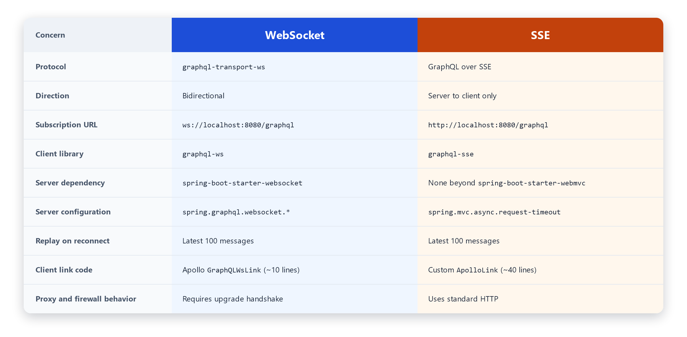
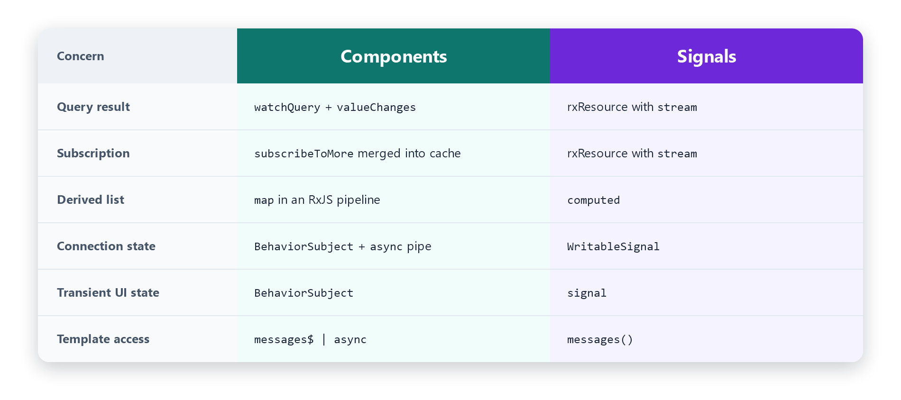

# Build Chat Application with Netflix DGS

In previous articles, you built a real-time chat application with Spring REST APIs over [Server-Sent Events](https://medium.com/@hantsy/building-a-chat-application-with-angular-and-spring-reactive-sse-c0fdddcd7d70) and [WebSocket](https://medium.com/@hantsy/building-a-chat-application-with-angular-and-spring-reactive-websocket-400e0769f4ec), and connected an Angular client to those APIs.

In this tutorial, you will build the same chat application with two key differences: the server exposes a GraphQL API through Netflix DGS, and the client communicates with it using [Apollo Client](https://www.apollographql.com/docs/angular/) instead of hand-written HTTP calls.

A chat application has three core responsibilities: load message history, send new messages, and receive messages in real time. GraphQL supports all three through its operation types: a **query** loads history, a **mutation** sends a message, and a **subscription** pushes new messages to connected clients.

## Prepare prerequisites

Before you begin, install or prepare the following:

- JDK 25. The samples target Spring Boot 4.1.2 and Kotlin 2.4.x.
- Node.js 24. The Angular clients use Angular 22 and the Vitest test runner.
- Git, if you want to clone and run the sample repository.

You do not need to install Maven separately. Spring Initializr generates a wrapper script (`mvnw`, or `mvnw.cmd` on Windows) in the project.

If you are new to DGS, read [Building GraphQL APIs with Netflix DGS](./start.md) first. That guide introduces core concepts and walks through creating a GraphQL API from scratch.

## Step 1: Generate project skeleton

With prerequisites in place, generate a project with [Spring Initializr](https://start.spring.io/) by following the instructions in [Building GraphQL APIs with Netflix DGS](./start.md). This tutorial differs in two ways: it uses Kotlin instead of Java, and it adds `GraphQL DGS` and `GraphQL DGS Codegen` dependencies manually. As usual, include `Spring Web` and `Spring WebSocket` starters.

The final `pom.xml` should look like this:

```xml
<properties>
    <java.version>25</java.version>
    <kotlin.version>2.4.21</kotlin.version>
    <dgs-platform.version>12.1.1</dgs-platform.version>
    <dgs-codegen-plugin.version>3.10.2</dgs-codegen-plugin.version>
</properties>

<dependencyManagement>
    <dependencies>
        <dependency>
            <groupId>com.netflix.graphql.dgs</groupId>
            <artifactId>graphql-dgs-platform-dependencies</artifactId>
            <version>${dgs-platform.version}</version>
            <type>pom</type>
            <scope>import</scope>
        </dependency>
    </dependencies>
</dependencyManagement>

<dependencies>
    <dependency>
        <groupId>com.netflix.graphql.dgs</groupId>
        <artifactId>dgs-starter</artifactId>
    </dependency>
    <dependency>
        <groupId>org.springframework.boot</groupId>
        <artifactId>spring-boot-starter-webmvc</artifactId>
    </dependency>
    <dependency>
        <groupId>org.springframework.boot</groupId>
        <artifactId>spring-boot-starter-websocket</artifactId>
    </dependency>
    <dependency>
        <groupId>io.projectreactor</groupId>
        <artifactId>reactor-core</artifactId>
    </dependency>
    <dependency>
        <groupId>org.jetbrains.kotlin</groupId>
        <artifactId>kotlin-stdlib</artifactId>
    </dependency>
    <dependency>
        <groupId>org.jetbrains.kotlin</groupId>
        <artifactId>kotlin-reflect</artifactId>
    </dependency>
</dependencies>
```

Each dependency serves a specific purpose:

- `dgs-starter` configures DGS and GraphQL execution support.
- `spring-boot-starter-webmvc` serves the HTTP endpoint.
- `spring-boot-starter-websocket` enables the WebSocket transport. In a servlet application, this starter enables the GraphQL WebSocket endpoint, which is disabled by default in Spring GraphQL.
- `reactor-core` provides reactive types for subscription results.

This initial implementation uses WebSocket for subscriptions. Later, you will switch to SSE.

Next, configure the Kotlin compiler and the code generation plugin. The generator reads the SDL schema and produces Kotlin data classes and a typed Java client API, so fetchers do not need hand-written types:

```xml
<build>
    <sourceDirectory>${project.basedir}/src/main/kotlin</sourceDirectory>
    <plugins>
        <plugin>
            <groupId>io.github.deweyjose</groupId>
            <artifactId>graphqlcodegen-maven-plugin</artifactId>
            <version>${dgs-codegen-plugin.version}</version>
            <executions>
                <execution>
                    <id>dgs-codegen</id>
                    <goals>
                        <goal>generate</goal>
                    </goals>
                    <configuration>
                        <language>kotlin</language>
                        <schemaPaths>
                            <param>${project.basedir}/src/main/resources/schema</param>
                        </schemaPaths>
                        <packageName>com.example.demo.gql</packageName>
                        <generateClientApi>true</generateClientApi>
                    </configuration>
                </execution>
            </executions>
        </plugin>
        <plugin>
            <groupId>org.jetbrains.kotlin</groupId>
            <artifactId>kotlin-maven-plugin</artifactId>
            <configuration>
                <compilerPlugins>
                    <plugin>spring</plugin>
                </compilerPlugins>
            </configuration>
        </plugin>
    </plugins>
</build>
```

Run `mvnw generate-sources` (or `mvnw.cmd generate-sources` on Windows) to generate code. Data classes are generated in `com.example.demo.gql.types`, and the typed client API is generated in `com.example.demo.gql.client`. The examples below use the generated types; the generated client API is useful when building a Java or Kotlin client against this schema.

## Step 2: Define GraphQL schema

After setting up the project, define the GraphQL contract. Because Netflix DGS is schema-first, the schema file drives the API design. Create `schema.graphql` under `src/main/resources/schema`:

```graphql
type TextMessage {
    id: ID!
    body: String!
    sentAt: LocalDateTime
}

type Query {
    messages: [TextMessage!]!
}

type Mutation {
    send(message: TextMessageInput!): TextMessage
}

input TextMessageInput {
    body: String!
}

type Subscription {
    messageSent: TextMessage!
}

scalar LocalDateTime
```

Each element maps directly to a chat requirement. `TextMessage` represents a chat message: `id` and `body` are required, and `sentAt` uses a `LocalDateTime` **custom scalar** for ISO-8601 timestamps. `Query.messages` loads message history, `Mutation.send` submits a new message, and `Subscription.messageSent` pushes new messages to every connected client.

Two details are worth noting. First, `send` returns the stored message, but clients do not rely on that response to render new messages because the subscription delivers them. The response is still valuable for correctness and error handling. Second, `messageSent` returns a single message per event rather than a list, because a subscription emits one result at a time and the event stream forms the full sequence.

The schema does not specify a transport. The same schema and the same `@DgsSubscription` method work for both WebSocket and SSE. As a result, switching transports later requires only client-side changes and a small server configuration update.

## Step 3: Implement data fetchers

With the schema in place, implement data fetchers to connect schema fields to application logic. In DGS, a `@DgsComponent` class contains resolver methods, and annotations map each method to a schema field. Subscription fetchers differ from queries and mutations because they return a reactive `Publisher`, and the transport forwards each emitted item to subscribers.

Create the following class in package `com.example.demo`:

```kotlin
@DgsComponent
class MessagesDataFetcher {

    @DgsQuery
    fun messages() = STORE.values

    @DgsMutation
    fun send(@InputArgument("message") message: TextMessageInput): TextMessage {
        val msg = TextMessage(
            id = UUID.randomUUID().toString(),
            body = message.body,
            sentAt = LocalDateTime.now()
        )
        STORE[msg.id] = msg
        sink.emitNext(msg, Sinks.EmitFailureHandler.FAIL_FAST)
        return msg
    }

    @DgsSubscription
    fun messageSent(): Publisher<TextMessage> = sink.asFlux()

    private val sink: Many<TextMessage> = Sinks.many().replay().limit(100)

    companion object {
        val STORE = mutableMapOf<String, TextMessage>()
    }
}
```

The annotations align with the schema without additional configuration. `@DgsQuery` binds `messages()` to `Query.messages`, `@DgsMutation` binds `send(...)` to `Mutation.send`, and `@DgsSubscription` binds `messageSent()` to `Subscription.messageSent`. In the mutation, `@InputArgument("message")` maps the GraphQL argument to the method parameter explicitly, because the parameter name differs from the generated input type name.

### Implement event stream

At the center of the chat server is a **sink**: a Reactor `Sinks.Many` that acts as a broadcast channel. Imperative code emits messages into the sink, and reactive subscribers consume them.

```kotlin
private val sink: Many<TextMessage> = Sinks.many().replay().limit(100)
```

`Sinks.many()` creates a sink with multiple subscribers, so each connected client receives the same stream. `.replay()` buffers previously emitted messages, allowing late subscribers to receive recent history. `.limit(100)` keeps the most recent 100 messages, which helps reconnecting clients catch up quickly. The SSE implementation uses the same buffer because its connections are short-lived and reconnect frequently.

```kotlin
sink.emitNext(msg, Sinks.EmitFailureHandler.FAIL_FAST)
```

When a mutation emits a message, every subscriber receives it immediately. `FAIL_FAST` fails emission immediately if the sink is closed or terminated, instead of queueing a message that cannot be delivered.

The subscription fetcher exposes the sink as a `Flux`:

```kotlin
@DgsSubscription
fun messageSent(): Publisher<TextMessage> = sink.asFlux()
```

!!! note
    `STORE` uses a plain `mutableMapOf`, which is not thread-safe. This is acceptable for a local sample with limited traffic. In a production application, use a thread-safe structure such as `ConcurrentHashMap` or persist messages in a database.

### Implement LocalDateTime scalar

Because the schema declares a custom `LocalDateTime` scalar, the server must provide a matching coercion implementation. Create `LocalDateTimeScalar` in package `com.example.demo`:

```kotlin
@DgsScalar(name = "LocalDateTime")
class LocalDateTimeScalar : Coercing<LocalDateTime, String> {

    @Throws(CoercingSerializeException::class)
    override fun serialize(dataFetcherResult: Any, graphQLContext: GraphQLContext, locale: Locale): String? {
        if (dataFetcherResult is LocalDateTime) {
            return dataFetcherResult.format(DateTimeFormatter.ISO_DATE_TIME)
        }
        throw CoercingSerializeException("Not a valid DateTime")
    }

    @Throws(CoercingParseValueException::class)
    override fun parseValue(input: Any, graphQLContext: GraphQLContext, locale: Locale): LocalDateTime? {
        if (input is String) {
            return LocalDateTime.parse(input, DateTimeFormatter.ISO_DATE_TIME)
        }
        throw CoercingParseLiteralException("Can not parse DateTime")
    }
    // parseLiteral and valueToLiteral follow the same pattern
}
```

`@DgsScalar` registers the implementation with the schema. A `Coercing` implementation handles three conversions: `serialize` converts a server-side value to a response value, `parseValue` converts an input variable to a server-side value, and `parseLiteral` converts an inline literal in a GraphQL document. Formatting with `DateTimeFormatter.ISO_DATE_TIME` ensures clients receive values such as `"2026-11-15T09:30:00.123"`.

### Enable browser access

With server logic ready, enable browser access from the Angular development server. By default, Angular runs on port 4200 and Spring Boot runs on port 8080, so browser requests are cross-origin and blocked unless the server explicitly allows them.

Add CORS configuration in a `WebMvcConfigurer`:

```kotlin
@Configuration
class WebConfig : WebMvcConfigurer {
    override fun addCorsMappings(registry: CorsRegistry) {
        registry.addMapping("/**")
    }
}
```

!!! note
    This configuration allows requests from any origin, which is convenient for local development but not recommended for production. Restrict allowed origins to trusted hosts, for example: `registry.addMapping("/graphql").allowedOrigins("http://localhost:4200")`.

### Configure WebSocket endpoint

To complete WebSocket setup, configure the GraphQL WebSocket endpoint in `src/main/resources/application.properties`:

```properties
spring.graphql.websocket.path=/graphql
spring.graphql.websocket.connection-init-timeout=30s
spring.graphql.websocket.keep-alive=60s
```

These properties enable and tune the WebSocket endpoint. `path` activates the endpoint and exposes it at `/graphql`, the same path used for HTTP requests. `connection-init-timeout` limits how long the server waits for a client `connection_init` message. `keep-alive` sends periodic `ping` frames to keep idle connections alive, which helps prevent intermediary proxies from closing them.

## Step 4: Test subscriptions

Before building a client UI, verify subscription behavior on the server. Manual browser testing is unreliable for subscriptions, so the sample projects include automated tests.

### Test subscription stream

Use `DgsQueryExecutor` to execute a subscription and return a publisher, then assert emitted values with Reactor `StepVerifier`. This test is transport-agnostic because it exercises fetcher logic directly. Create `SubscriptionTest` in `src/test/kotlin/com/example/demo`:

```kotlin
@SpringBootTest
@EnableDgsTest
class SubscriptionTest {

    @Autowired
    lateinit var dgsQueryExecutor: DgsQueryExecutor

    @Test
    fun testMessages() {
        val executionResult = dgsQueryExecutor.execute("subscription { messageSent { body } }")
        val publisher = executionResult.getData<Publisher<ExecutionResult>>()

        val verifier = StepVerifier.create(publisher)
            .consumeNextWith {
                assertThat(
                    it.getData<Map<String, Map<String, Any>>>()["messageSent"]
                        ?.get("body") as String
                ).contains("text1")
            }
            .consumeNextWith {
                assertThat(
                    it.getData<Map<String, Map<String, Any>>>()["messageSent"]
                        ?.get("body") as String
                ).contains("text2")
            }
            .thenCancel()
            .verifyLater()

        val sendText1 = dgsQueryExecutor.executeAndExtractJsonPath<String>(
            "mutation sendMessage(\$msg: TextMessageInput!) { send(message:\$msg) { body}}",
            "data.send.body",
            mapOf("msg" to (mapOf("body" to "text1 message")))
        )
        assertThat(sendText1).contains("text1")

        val sendText2 = dgsQueryExecutor.executeAndExtractJsonPath<String>(
            "mutation sendMessage(\$msg: TextMessageInput!) { send(message:\$msg) { body}}",
            "data.send.body",
            mapOf("msg" to (mapOf("body" to "text2 message")))
        )
        assertThat(sendText2).contains("text2")

        // verify it now.
        verifier.verify()
    }
}
```

Execution order is critical. Start verification with `verifyLater()`, send mutations, and then call `verify()`. The subscription must be active before mutations run; otherwise, emitted messages can be missed.

### Test over WebSocket transport

In-process tests confirm fetcher behavior but do not validate protocol behavior. To test transport behavior, use Spring GraphQL's `WebSocketGraphQlClient`:

```kotlin
@SpringBootTest(webEnvironment = SpringBootTest.WebEnvironment.RANDOM_PORT)
class IntegrationTests {

    @LocalServerPort
    var port = 0

    lateinit var webClient: DgsWebClientGraphQLClient
    lateinit var socketClient: WebSocketGraphQlClient

    @BeforeEach
    fun setup() {
        val baseUrl = "http://localhost:$port/graphql"
        this.webClient = DgsWebClientGraphQLClient(WebClient.create(baseUrl))

        val subscriptionUrl = "ws://localhost:$port/graphql"
        this.socketClient = WebSocketGraphQlClient.create(
            URI.create(subscriptionUrl),
            ReactorNettyWebSocketClient()
        )
        this.socketClient.start().subscribe()
    }

    @AfterEach
    fun teardown() {
        this.socketClient.stop().subscribe()
    }

    @Test
    fun testMessages() {
        val executionResult = socketClient.document("subscription { messageSent { body } }")
            .executeSubscription()
            .map {
                val messageSent = it.getData<Map<String, Any>>()!!["messageSent"]!! as Map<String, Any>
                messageSent["body"] as String
            }

        val verifier = StepVerifier.create(executionResult)
            .thenAwait(Duration.ofMillis(1500))
            .consumeNextWith { assertThat(it).isEqualTo("text1") }
            .consumeNextWith { assertThat(it).isEqualTo("text2") }
            .thenCancel()
            .verifyLater()

        // give the websocket subscription time to register on the server before sending,
        // otherwise the first message may be emitted before the subscription is active
        Thread.sleep(1000)

        // send the messages over HTTP, then
        verifier.verify()
    }
}
```

As with the in-process test, the subscription must be registered before mutations run. This integration test waits explicitly to account for WebSocket handshake latency.

## Step 5: Build Angular client

After validating the server, build an Angular client that consumes the API. The UI contains three elements: a message list, a text field, and a send button. Under the hood, **Apollo Client** integrates with Angular through **apollo-angular**, and subscriptions use a WebSocket transport link.

### Create project

Generate an Angular application with Angular CLI:

```bash
ng new dgs-subscription-ui --style=scss --routing=false --skip-git
```

Add Angular Material for form controls:

```bash
ng add @angular/material
```

Then install GraphQL dependencies:

```bash
npm install @apollo/client apollo-angular graphql graphql-ws
```

### Define endpoint configuration

Define endpoint constants in `src/app/config.ts`:

```typescript
export const GRAPHQL_HTTP_URL = 'http://localhost:8080/graphql';
export const GRAPHQL_WS_URL = 'ws://localhost:8080/graphql';
```

Two URLs are required because queries and mutations use HTTP, while subscriptions use WebSocket. Both endpoints share the same path; protocol and upgrade headers determine transport behavior.

### Define GraphQL types

Collect operation-related types and documents in `src/app/graphql/messages.ts`:

```typescript
import { gql } from 'apollo-angular';

export interface TextMessage {
  id: string;
  body: string;
  sentAt: string | null;
}

export interface MessagesData {
  messages: TextMessage[];
}

export interface SendMessageData {
  send: TextMessage | null;
}

export interface MessageSentData {
  messageSent: TextMessage;
}

export const MESSAGES_QUERY = gql`
  query allMessages {
    messages {
      id
      body
      sentAt
    }
  }
`;

export const SEND_MESSAGE_MUTATION = gql`
  mutation sendMessage($message: TextMessageInput!) {
    send(message: $message) {
      id
      body
      sentAt
    }
  }
`;

export const MESSAGE_SENT_SUBSCRIPTION = gql`
  subscription onMessageSent {
    messageSent {
      id
      body
      sentAt
    }
  }
`;

export function mergeNewMessage(
  prev: MessagesData,
  options: { subscriptionData: { data?: MessageSentData | null } },
): MessagesData {
  const incoming = options.subscriptionData.data?.messageSent;
  if (!incoming) {
    return prev;
  }
  return { messages: [...(prev?.messages ?? []), incoming] };
}

export function describeError(err: unknown): string {
  if (Array.isArray(err)) {
    return err.map(describeError).join('; ');
  }
  if (err instanceof Error) {
    return err.message;
  }
  if (err && typeof err === 'object' && 'message' in err) {
    return String((err as { message: unknown }).message);
  }
  return String(err);
}
```

This module defines one document per operation. `mergeNewMessage` merges subscription events into query results, and `describeError` normalizes different Apollo error shapes into a user-facing message.

### Create WebSocket transport link

Create a WebSocket transport link in `src/app/transport/ws-link.ts`:

```typescript
import { GraphQLWsLink } from '@apollo/client/link/subscriptions';
import { createClient, type ClientOptions } from 'graphql-ws';
import { BehaviorSubject } from 'rxjs';

export type ConnectionState = 'idle' | 'connecting' | 'open' | 'closed' | 'error';

// A dropped socket does not surface through QueryRef.valueChanges, so the transport
// publishes its own state for the component to render as a banner.
export const connectionState$ = new BehaviorSubject<ConnectionState>('idle');

export const wsClientListeners: NonNullable<ClientOptions['on']> = {
  connecting: () => connectionState$.next('connecting'),
  connected: () => connectionState$.next('open'),
  closed: () => connectionState$.next('closed'),
  error: () => connectionState$.next('error'),
};

export function createWsLink(url: string): GraphQLWsLink {
  return new GraphQLWsLink(
    createClient({ url, on: wsClientListeners }),
  );
}
```

`createClient` from `graphql-ws` manages socket connection, `graphql-transport-ws` handshake, and heartbeat frames. Connection listeners publish transport state so the UI can display status changes explicitly.

### Configure Apollo client

Configure Apollo in `appProviders` inside `src/app/app.config.ts`:

```typescript
import { provideHttpClient } from '@angular/common/http';
import { inject, provideZonelessChangeDetection, type EnvironmentProviders, type Provider } from '@angular/core';
import { provideAnimationsAsync } from '@angular/platform-browser/animations/async';
import { InMemoryCache, split } from '@apollo/client';
import { getMainDefinition } from '@apollo/client/utilities';
import { provideApollo } from 'apollo-angular';
import { HttpLink } from 'apollo-angular/http';
import { GRAPHQL_HTTP_URL, GRAPHQL_WS_URL } from './config';
import { createWsLink } from './transport/ws-link';

export function appProviders(): (Provider | EnvironmentProviders)[] {
  return [
    provideZonelessChangeDetection(),
    provideAnimationsAsync(),
    provideHttpClient(),
    provideApollo(() => {
      const httpLink = inject(HttpLink).create({ uri: GRAPHQL_HTTP_URL });
      const wsLink = createWsLink(GRAPHQL_WS_URL);

      return {
        link: split(
          ({ query }) => {
            const definition = getMainDefinition(query);
            return (
              definition.kind === 'OperationDefinition' &&
              definition.operation === 'subscription'
            );
          },
          wsLink,
          httpLink,
        ),
        cache: new InMemoryCache(),
      };
    }),
  ];
}
```

The **split link** routes operations by type: subscriptions go through the WebSocket link, and queries and mutations go through the HTTP link. This allows one Apollo client to handle multiple transports transparently.

### Build chat component

Implement the chat component in `src/app/app.component.ts` to combine query, mutation, and subscription behavior:

```typescript
import { AsyncPipe } from '@angular/common';
import { Component, inject, OnDestroy, OnInit } from '@angular/core';
import { FormBuilder, ReactiveFormsModule, Validators } from '@angular/forms';
import { MatButtonModule } from '@angular/material/button';
import { MatFormFieldModule } from '@angular/material/form-field';
import { MatIconModule } from '@angular/material/icon';
import { MatInputModule } from '@angular/material/input';
import { Apollo } from 'apollo-angular';
import { BehaviorSubject, catchError, map, Observable, of, shareReplay } from 'rxjs';
import {
  MESSAGES_QUERY,
  MESSAGE_SENT_SUBSCRIPTION,
  SEND_MESSAGE_MUTATION,
  describeError,
  mergeNewMessage,
  type MessageSentData,
  type MessagesData,
  type SendMessageData,
  type TextMessage,
} from './graphql/messages';
import { connectionState$, type ConnectionState } from './transport/ws-link';

interface QueryState {
  loading: boolean;
  messages: TextMessage[];
  error: string | null;
}

@Component({
  selector: 'app-root',
  standalone: true,
  templateUrl: './app.component.html',
  styleUrl: './app.component.css',
  imports: [
    AsyncPipe,
    ReactiveFormsModule,
    MatFormFieldModule,
    MatInputModule,
    MatButtonModule,
    MatIconModule,
  ],
})
export class AppComponent implements OnInit, OnDestroy {
  private readonly apollo = inject(Apollo);
  private readonly fb = inject(FormBuilder);

  readonly form = this.fb.nonNullable.group({ body: ['', Validators.required] });

  private readonly messagesQueryRef = this.apollo.watchQuery<MessagesData>({
    query: MESSAGES_QUERY,
  });

  // One shared subscription feeds both the list and the error banner, so the
  // query is issued once no matter how many async pipes read it.
  private readonly queryState$: Observable<QueryState> = this.messagesQueryRef.valueChanges.pipe(
    map(result => ({
      loading: result.loading,
      // Apollo types an in-flight result as a deep partial; a resolved result is complete.
      messages: (result.data?.messages ?? []) as TextMessage[],
      error: result.error ? describeError(result.error) : null,
    })),
    catchError(err =>
      of<QueryState>({ loading: false, messages: [], error: describeError(err) }),
    ),
    shareReplay({ bufferSize: 1, refCount: true }),
  );

  readonly messages$: Observable<TextMessage[] | null> = this.queryState$.pipe(
    map(state => (state.loading ? null : state.messages)),
  );

  readonly error$: Observable<string | null> = this.queryState$.pipe(
    map(state => state.error),
  );

  readonly connectionState$: Observable<ConnectionState> = connectionState$;

  private readonly sendingSubject = new BehaviorSubject<boolean>(false);
  readonly sending$: Observable<boolean> = this.sendingSubject.asObservable();

  private readonly sendErrorSubject = new BehaviorSubject<string | null>(null);
  readonly sendError$: Observable<string | null> = this.sendErrorSubject.asObservable();

  private stopSubscription?: () => void;

  ngOnInit(): void {
    // Pushed messages are merged into the query result, so no separate stream is
    // rendered; the cache broadcast is what updates the list.
    this.stopSubscription = this.messagesQueryRef.subscribeToMore<MessageSentData>({
      document: MESSAGE_SENT_SUBSCRIPTION,
      updateQuery: (prev, { subscriptionData }) =>
        mergeNewMessage(
          { messages: (prev?.messages ?? []) as TextMessage[] },
          { subscriptionData },
        ),
    });
  }

  ngOnDestroy(): void {
    this.stopSubscription?.();
  }

  send(): void {
    const body = this.form.controls.body.value.trim();
    if (!body) {
      return;
    }

    this.sendingSubject.next(true);
    this.sendErrorSubject.next(null);

    this.apollo
      .mutate<SendMessageData>({
        mutation: SEND_MESSAGE_MUTATION,
        variables: { message: { body } },
      })
      .subscribe({
        next: result => {
          this.sendingSubject.next(false);
          if (result.error) {
            this.sendErrorSubject.next(describeError(result.error));
            return;
          }
          // the new message arrives through the subscription, not from this response
          this.form.controls.body.reset('');
        },
        error: err => {
          this.sendingSubject.next(false);
          this.sendErrorSubject.next(describeError(err));
        },
      });
  }
}
```

This component coordinates three operations. The **query** uses `watchQuery` so Apollo can update results when cache data changes. The **subscription** uses `subscribeToMore` to merge incoming events into query results, and cache updates drive UI rendering. The **mutation** sends new messages but does not append them directly to the list; subscription events handle that. The mutation response is used for form reset and error reporting.

`subscribeToMore` returns a teardown function. Call it in `ngOnDestroy` to close the subscription when the component is destroyed.

The corresponding template renders message history, transport status, and input controls:

```html
<main class="container">
  <h1>DGS Subscription — WebSocket</h1>

  @if (connectionState$ | async; as state) {
    @if (state !== 'open' && state !== 'idle') {
      <p class="banner" role="status">Subscription {{ state }}</p>
    }
  }

  @if (error$ | async; as err) {
    <p class="banner banner-error" role="alert">{{ err }}</p>
  }

  @if (messages$ | async; as messages) {
    <ul class="messages">
      @for (m of messages; track m.id) {
        <li>
          <span class="body">{{ m.body }}</span>
          <time class="sent-at">{{ m.sentAt }}</time>
        </li>
      } @empty {
        <li class="empty">No messages yet.</li>
      }
    </ul>
  } @else {
    <ul class="messages">
      <li class="empty">Loading messages…</li>
    </ul>
  }

  <form class="message-box" [formGroup]="form" (ngSubmit)="send()">
    <mat-form-field class="message-field">
      <mat-label>Message</mat-label>
      <input matInput formControlName="body" name="body" autocomplete="off" />
      @if (form.controls.body.hasError('required')) {
        <mat-error>Message body can not be empty.</mat-error>
      }
    </mat-form-field>

    <button
      mat-icon-button
      type="submit"
      [disabled]="form.invalid || (sending$ | async)"
      aria-label="Send message"
    >
      <mat-icon>send</mat-icon>
    </button>
  </form>

  @if (sendError$ | async; as err) {
    <p class="banner banner-error" role="alert">{{ err }}</p>
  }
</main>
```

The top banner reports connection state whenever the transport is not open.

## Step 6: Run server and client applications

With both server and client implemented, run them locally to verify end-to-end behavior. The server and client run in separate directories and processes.

### Start server

In the server project directory, start the Spring Boot application:

```bash
cd dgs-subscription-ws
./mvnw spring-boot:run
```

On Windows, use `mvnw.cmd spring-boot:run`. This sample does not require a database, so no Docker setup is needed.

When the log shows `Started DemoApplication`, the server is available at `http://localhost:8080`.

### Start client

Open a second terminal and start the Angular development server:

```bash
cd dgs-subscription-ui
npm install
npm start
```

Open `http://localhost:4200`. You should see an empty message list above the input field.

### Test in browser

1. Enter a message and click send. The message appears in the list and the input field is cleared.
2. Open `http://localhost:4200` in a second browser tab. Send a message from one tab and confirm it appears in the other. This confirms subscription delivery to all connected clients.
3. Stop the server process. The connection banner should appear when the socket closes. Restart the server and reload the page to reconnect.

### Explore API with curl

Queries and mutations are standard HTTP requests, so you can test them with `curl`.

List stored messages:

```bash
curl http://localhost:8080/graphql \
  -H "Content-Type: application/json" \
  -d '{"query": "{ messages { id body sentAt } }"}'
```

Send a message:

```bash
curl http://localhost:8080/graphql \
  -H "Content-Type: application/json" \
  -d '{
    "query": "mutation sendMessage($message: TextMessageInput!) { send(message: $message) { id body sentAt } }",
    "variables": { "message": { "body": "Hello from curl" } }
  }'
```

WebSocket subscriptions are harder to inspect from a shell because `graphql-transport-ws` requires a `connection_init` handshake before operations can run. Use browser developer tools to inspect frames, rely on the integration test in Step 4 for protocol-level verification, or use a tool such as `websocat` for manual frame inspection. The SSE variant introduced next is easier to observe with a single `curl` command.

You can also use GraphiQL at `http://localhost:8080/graphiql` for interactive query and mutation testing.

## Switch to SSE subscriptions

The WebSocket implementation works well and supports bidirectional communication. However, it is more demanding operationally because every proxy, load balancer, and firewall in the path must support the HTTP upgrade handshake.

**Server-Sent Events** simplify this by using a standard HTTP response stream. An SSE subscription is a regular HTTP request with a long-lived response, where the server writes one event per message. No protocol upgrade is required, so existing HTTP infrastructure usually handles it without special configuration.

Server-side changes are minimal. Client-side changes are more substantial because Apollo does not provide a built-in SSE link.

### Update server for SSE

Because SSE subscriptions use the HTTP endpoint, remove the WebSocket starter from `pom.xml`:

```xml
<dependency>
    <groupId>org.springframework.boot</groupId>
    <artifactId>spring-boot-starter-websocket</artifactId>
</dependency>
```

Keeping it does not break the application, but the `dgs-subscription-sse` sample removes it for clarity.

Adjust asynchronous request timeout for long-lived SSE responses:

```properties
spring.mvc.async.request-timeout=45000
```

An SSE subscription keeps an asynchronous servlet request open. This timeout ends the stream after 45 seconds.

Keep the same replay buffer to support reconnect catch-up:

```kotlin
private val sink: Many<TextMessage> = Sinks.many().replay().limit(100)
```

With a 45-second timeout, the server closes the stream periodically and the `graphql-sse` client reconnects automatically. The replay buffer allows clients to recover recently missed messages.

### Update client for SSE

Replace the WebSocket transport dependency:

```bash
npm uninstall graphql-ws
npm install graphql-sse
```

`graphql-sse` retries disconnects automatically by default (five attempts with randomized exponential backoff), configurable through `retryAttempts` and `retry`.

Update endpoint configuration in `src/app/config.ts` to use only the HTTP URL:

```typescript
export const GRAPHQL_HTTP_URL = 'http://localhost:8080/graphql';
```

Because Apollo does not ship an SSE subscription link, implement one in `src/app/transport/sse-link.ts`:

```typescript
import { ApolloLink, type FetchResult, type Operation } from '@apollo/client';
import { print, type DocumentNode } from 'graphql';
import { createClient, type Client, type ClientOptions } from 'graphql-sse';
import { BehaviorSubject, Observable } from 'rxjs';

export type ConnectionState = 'idle' | 'connecting' | 'open' | 'closed' | 'error';

// A dropped stream does not surface through QueryRef.valueChanges, so the transport
// publishes its own state for the component to render as a banner.
export const connectionState$ = new BehaviorSubject<ConnectionState>('idle');

// graphql-sse exposes only connecting/message/connected at client level. The closed
// and error transitions are detected in the link's sink instead, see request() below.
export const sseClientListeners: NonNullable<ClientOptions<false>['on']> = {
  connecting: () => connectionState$.next('connecting'),
  connected: () => connectionState$.next('open'),
};

export function createSseClient(url: string): Client {
  return createClient({ url, on: sseClientListeners });
}

export class GraphQLSSELink extends ApolloLink {
  constructor(private readonly client: Client) {
    super();
  }

  override request(operation: Operation): Observable<FetchResult> {
    return new Observable<FetchResult>(observer => {
      const dispose = this.client.subscribe(
        {
          query: print(operation.query as DocumentNode),
          variables: operation.variables,
          operationName: operation.operationName,
          extensions: operation.extensions,
        },
        {
          next: result => observer.next(result as unknown as FetchResult),
          error: err => {
            connectionState$.next('error');
            observer.error(Array.isArray(err) ? err : [err]);
          },
          complete: () => {
            connectionState$.next('closed');
            observer.complete();
          },
        },
      );

      return dispose;
    });
  }
}
```

This link performs three tasks: it converts Apollo operations into `graphql-sse` request payloads, forwards SSE events to RxJS observers, and returns a dispose function so unsubscribing closes the stream.

Compared with the WebSocket link, this implementation also tracks `closed` and `error` states manually because `graphql-sse` reports only `connecting` and `connected` at client level.

Update Apollo configuration to use the SSE link:

```typescript
import { provideHttpClient } from '@angular/common/http';
import { inject, provideZonelessChangeDetection, type EnvironmentProviders, type Provider } from '@angular/core';
import { provideAnimationsAsync } from '@angular/platform-browser/animations/async';
import { InMemoryCache, split } from '@apollo/client';
import { getMainDefinition } from '@apollo/client/utilities';
import { provideApollo } from 'apollo-angular';
import { HttpLink } from 'apollo-angular/http';
import { GRAPHQL_HTTP_URL } from './config';
import { GraphQLSSELink, createSseClient } from './transport/sse-link';

export function appProviders(): (Provider | EnvironmentProviders)[] {
  return [
    provideZonelessChangeDetection(),
    provideAnimationsAsync(),
    provideHttpClient(),
    provideApollo(() => {
      const httpLink = inject(HttpLink).create({ uri: GRAPHQL_HTTP_URL });
      const sseLink = new GraphQLSSELink(createSseClient(GRAPHQL_HTTP_URL));

      return {
        link: split(
          ({ query }) => {
            const definition = getMainDefinition(query);
            return (
              definition.kind === 'OperationDefinition' &&
              definition.operation === 'subscription'
            );
          },
          sseLink,
          httpLink,
        ),
        cache: new InMemoryCache(),
      };
    }),
  ];
}
```

No component changes are required. Because transport selection is encapsulated in the link layer, the UI remains unchanged.

### Run SSE version

Start the SSE server and client variants.

Start the server:

```bash
cd dgs-subscription-sse
./mvnw spring-boot:run
```

Start the client:

```bash
cd dgs-subscription-ui-sse
npm install
npm start
```

Application behavior remains the same. In browser developer tools, you will now see an open event-stream response instead of a WebSocket connection.

To observe the subscription from a terminal, run:

```bash
curl -N http://localhost:8080/graphql \
  -H "Content-Type: application/json" \
  -H "Accept: text/event-stream" \
  -d '{"query": "subscription { messageSent { id body sentAt } }"}'
```

The `-N` flag disables output buffering, and `Accept: text/event-stream` selects SSE transport. The response remains open and emits one event per message. Event framing follows the [GraphQL over SSE protocol](https://github.com/enisdenjo/graphql-sse/blob/master/PROTOCOL.md): `next` events carry execution results, followed by a `complete` event when the stream ends.

```text
event:next
data:{"data":{"messageSent":{"id":"3a2f...","body":"Hello from curl","sentAt":"2026-11-15T09:30:00.123"}}}
```

Send a mutation from another terminal while the subscription is open to see events arrive immediately. Press `Ctrl+C` to close the stream.

### Compare WebSocket and SSE

The two transports differ far less on the server than on the client:



!!! warning
    The two WebSocket protocols are not interchangeable. This tutorial uses the maintained `graphql-transport-ws` subprotocol, not the deprecated `subscriptions-transport-ws` protocol. Client and server must use the same protocol.

### Test SSE transport

The SSE variant includes an integration test using DGS's SSE client:

```kotlin
package com.example.demo

import com.jayway.jsonpath.TypeRef
import com.netflix.graphql.dgs.client.DgsGraphqlSSESubscriptionGraphQLClient
import com.netflix.graphql.dgs.client.DgsRestClientGraphQLClient
import org.assertj.core.api.Assertions.assertThat
import org.junit.jupiter.api.BeforeEach
import org.junit.jupiter.api.Test
import org.springframework.boot.test.context.SpringBootTest
import org.springframework.boot.test.web.server.LocalServerPort
import org.springframework.web.client.RestClient
import org.springframework.web.reactive.function.client.WebClient
import reactor.test.StepVerifier

@SpringBootTest(webEnvironment = SpringBootTest.WebEnvironment.RANDOM_PORT)
class IntegrationTests {

    @LocalServerPort
    var port = 0;

    // The Dgs-prefixed clients are the Jackson 3 variants; GraphqlSSESubscriptionGraphQLClient and
    // RestClientGraphQLClient are their Jackson 2 predecessors.
    lateinit var sseClient: DgsGraphqlSSESubscriptionGraphQLClient
    lateinit var restClient: DgsRestClientGraphQLClient

    @BeforeEach
    fun setup() {
        val baseUrl = "http://localhost:$port/graphql"
        sseClient = DgsGraphqlSSESubscriptionGraphQLClient(
            baseUrl,
            WebClient.create(baseUrl)
        )
        restClient = DgsRestClientGraphQLClient(RestClient.builder().baseUrl(baseUrl).build())
    }

    @Test
    fun testMessages() {
        val subscriptionQuery = "subscription { messageSent { body } }"
        val variables = emptyMap<String, Any>()
        val result = sseClient.reactiveExecuteQuery(subscriptionQuery, variables).map {
            it.extractValueAsObject("data.messageSent", object : TypeRef<Map<String, Any>>() {})["body"] as String
        }

        val verifier = StepVerifier.create(result)
            .consumeNextWith { assertThat(it).isEqualTo("text1 message") }
            .consumeNextWith { assertThat(it).isEqualTo("text2 message") }
            .thenCancel()
            .verifyLater()

        val sendMessageQuery = "mutation sendMessage(\$msg: TextMessageInput!) { send(message:\$msg) { body}}"

        val sendText1 = restClient.executeQuery(
            sendMessageQuery,
            mapOf("msg" to (mapOf("body" to "text1 message")))
        ).extractValueAsObject("data.send.body", String::class.java)
        assertThat(sendText1).isEqualTo("text1 message")

        val sendText2 = restClient.executeQuery(
            sendMessageQuery,
            mapOf("msg" to (mapOf("body" to "text2 message")))
        ).extractValueAsObject("data.send.body", String::class.java)
        assertThat(sendText2).isEqualTo("text2 message")

        //verify it now.
        verifier.verify();

        val allMessagesQuery = " { messages { body }}"

        val allMessages = restClient.executeQuery(allMessagesQuery, emptyMap<String, Any>())
            .extractValueAsObject("data.messages[*].body", object : TypeRef<List<String>>() {})
        assertThat(allMessages).allMatch { s: String -> s.contains("message") }
    }
}
```

As with WebSocket, the subscription must be active before mutations execute.

## Switch Angular client to signals

The component-based client works correctly, but it relies heavily on RxJS observables and `async` pipes. You can implement the same behavior with Angular signals and the `rxResource` interop API.

### Publish signal from transport

Update the transport state holder to use signals. In `src/app/transport/ws-link.ts`:

```typescript
import { signal, type WritableSignal } from '@angular/core';
import { GraphQLWsLink } from '@apollo/client/link/subscriptions';
import { createClient, type ClientOptions } from 'graphql-ws';

export type ConnectionState = 'idle' | 'connecting' | 'open' | 'closed' | 'error';

export const connectionState: WritableSignal<ConnectionState> = signal<ConnectionState>('idle');

export const wsClientListeners: NonNullable<ClientOptions['on']> = {
  connecting: () => connectionState.set('connecting'),
  connected: () => connectionState.set('open'),
  closed: () => connectionState.set('closed'),
  error: () => connectionState.set('error'),
};

export function createWsLink(url: string): GraphQLWsLink {
  return new GraphQLWsLink(
    createClient({ url, on: wsClientListeners }),
  );
}
```

A `WritableSignal` replaces `BehaviorSubject`. The SSE signals variant applies the same change in `sse-link.ts`, while `GraphQLSSELink` remains unchanged.

### Refactor component

Refactor `src/app/app.component.ts` to use `rxResource` and computed signals:

```typescript
import { Component, computed, inject, signal } from '@angular/core';
import { rxResource } from '@angular/core/rxjs-interop';
import { FormBuilder, ReactiveFormsModule, Validators } from '@angular/forms';
import { MatButtonModule } from '@angular/material/button';
import { MatFormFieldModule } from '@angular/material/form-field';
import { MatIconModule } from '@angular/material/icon';
import { MatInputModule } from '@angular/material/input';
import { Apollo } from 'apollo-angular';
import { catchError, filter, map, of } from 'rxjs';
import {
  MESSAGES_QUERY,
  MESSAGE_SENT_SUBSCRIPTION,
  SEND_MESSAGE_MUTATION,
  describeError,
  type MessageSentData,
  type MessagesData,
  type SendMessageData,
} from './graphql/messages';
import { connectionState } from './transport/ws-link';

@Component({
  selector: 'app-root',
  standalone: true,
  templateUrl: './app.component.html',
  styleUrl: './app.component.css',
  imports: [
    ReactiveFormsModule,
    MatFormFieldModule,
    MatInputModule,
    MatButtonModule,
    MatIconModule,
  ],
})
export class AppComponent {
  private readonly apollo = inject(Apollo);
  private readonly fb = inject(FormBuilder);

  readonly form = this.fb.nonNullable.group({ body: ['', Validators.required] });

  // ── Query as a one-time resource ──────────────────────────────────────
  // rxResource accepts Observables via 'stream'; the Apollo query Observable
  // emits once and completes, which is valid here.
  readonly messagesResource = rxResource({
    stream: () =>
      this.apollo.query<MessagesData>({ query: MESSAGES_QUERY }).pipe(
        map(r => r.data?.messages ?? []),
      ),
  });

  // ── Subscription as a streaming resource ──────────────────────────────
  // rxResource accepts Observables natively in 'stream', so no toSignal() bridge
  // is needed. Each emission from the Apollo subscription updates the resource value.
  readonly subscriptionResource = rxResource({
    stream: () =>
      this.apollo.subscribe<MessageSentData>({ query: MESSAGE_SENT_SUBSCRIPTION }).pipe(
        filter(result => !!result.data),
        map(result => (result.data as MessageSentData).messageSent ?? null),
        catchError(() => of(null)),
      ),
  });

  // ── Computed signals ──────────────────────────────────────────────────
  readonly messages = computed(() => {
    const initial = this.messagesResource.hasValue() ? this.messagesResource.value()! : [];
    const newMessage = this.subscriptionResource.hasValue()
      ? this.subscriptionResource.value()
      : null;
    if (!newMessage) return initial;
    return [...initial, newMessage];
  });

  readonly loading = computed(() => this.messagesResource.isLoading());
  readonly error = computed(() => {
    const err = this.messagesResource.error();
    return err ? describeError(err) : null;
  });

  readonly connection = connectionState;

  readonly sending = signal(false);
  readonly sendError = signal<string | null>(null);

  send(): void {
    const body = this.form.controls.body.value.trim();
    if (!body) {
      return;
    }

    this.sending.set(true);
    this.sendError.set(null);

    this.apollo
      .mutate<SendMessageData>({
        mutation: SEND_MESSAGE_MUTATION,
        variables: { message: { body } },
      })
      .subscribe({
        next: result => {
          this.sending.set(false);
          if (result.error) {
            this.sendError.set(describeError(result.error));
            return;
          }
          // the new message arrives through the subscription, not from this response
          this.form.controls.body.reset('');
        },
        error: err => {
          this.sending.set(false);
          this.sendError.set(describeError(err));
        },
      });
  }
}
```

The template keeps the same structure and replaces pipe syntax with signal calls:

```html
<main class="container">
  <h1>DGS Subscription — WebSocket</h1>

  @if (connection() !== 'open' && connection() !== 'idle') {
    <p class="banner" role="status">Subscription {{ connection() }}</p>
  }

  @if (error(); as err) {
    <p class="banner banner-error" role="alert">{{ err }}</p>
  }

  <ul class="messages">
    @for (m of messages(); track m.id) {
      <li>
        <span class="body">{{ m.body }}</span>
        <time class="sent-at">{{ m.sentAt }}</time>
      </li>
    } @empty {
      <li class="empty">
        @if (loading()) { Loading messages… } @else { No messages yet. }
      </li>
    }
  </ul>

  <form class="message-box" [formGroup]="form" (ngSubmit)="send()">
    <mat-form-field class="message-field">
      <mat-label>Message</mat-label>
      <input matInput formControlName="body" name="body" autocomplete="off" />
      @if (form.controls.body.hasError('required')) {
        <mat-error>Message body can not be empty.</mat-error>
      }
    </mat-form-field>

    <button
      mat-icon-button
      type="submit"
      [disabled]="form.invalid || sending()"
      aria-label="Send message"
    >
      <mat-icon>send</mat-icon>
    </button>
  </form>

  @if (sendError(); as err) {
    <p class="banner banner-error" role="alert">{{ err }}</p>
  }
</main>
```

The component-based and signal-based implementations differ in these areas:



!!! note
    Behavior differs in one important way. The component-based version merges every pushed message into the query result, so the list grows over time. The signal-based version appends only the latest pushed message to the initial list because a resource stores only the most recent stream value. To accumulate all pushed messages, store them in a signal array and append in the stream pipeline:

    ```typescript
    readonly pushed = signal<TextMessage[]>([]);

    readonly subscriptionResource = rxResource({
      stream: () =>
        this.apollo.subscribe<MessageSentData>({ query: MESSAGE_SENT_SUBSCRIPTION }).pipe(
          filter(result => !!result.data),
          map(result => (result.data as MessageSentData).messageSent ?? null),
          tap(message => {
            if (message) {
              this.pushed.update(list => [...list, message]);
            }
          }),
        ),
    });

    readonly messages = computed(() => [
      ...(this.messagesResource.hasValue() ? this.messagesResource.value()! : []),
      ...this.pushed(),
    ]);
    ```

    In this approach, Apollo cache remains the source of truth for the initial query, while the signal array stores subscription messages received during the current page session.

## Explore example projects

Each step in this tutorial maps to a module in the [spring-graphql-sample repository](https://github.com/hantsy/spring-graphql-sample):

- [`dgs-subscription-ws`](https://github.com/hantsy/spring-graphql-sample/tree/master/dgs-subscription-ws)
  implements the DGS server with WebSocket subscriptions.
- [`dgs-subscription-ui`](https://github.com/hantsy/spring-graphql-sample/tree/master/dgs-subscription-ui)
  provides the Angular component-based client with WebSocket transport.
- [`dgs-subscription-ui-signals`](https://github.com/hantsy/spring-graphql-sample/tree/master/dgs-subscription-ui-signals)
  provides the Angular signals-based client with WebSocket transport.
- [`dgs-subscription-sse`](https://github.com/hantsy/spring-graphql-sample/tree/master/dgs-subscription-sse)
  implements the DGS server with SSE subscriptions.
- [`dgs-subscription-ui-sse`](https://github.com/hantsy/spring-graphql-sample/tree/master/dgs-subscription-ui-sse)
  provides the Angular component-based client with SSE transport.
- [`dgs-subscription-ui-sse-signals`](https://github.com/hantsy/spring-graphql-sample/tree/master/dgs-subscription-ui-sse-signals)
  provides the Angular signals-based client with SSE transport.

For broader DGS coverage, see [Building GraphQL APIs with Netflix DGS](./start.md). For protocol details behind WebSocket and SSE subscriptions, see [An introduction to GraphQL and Spring](../intro.md).
