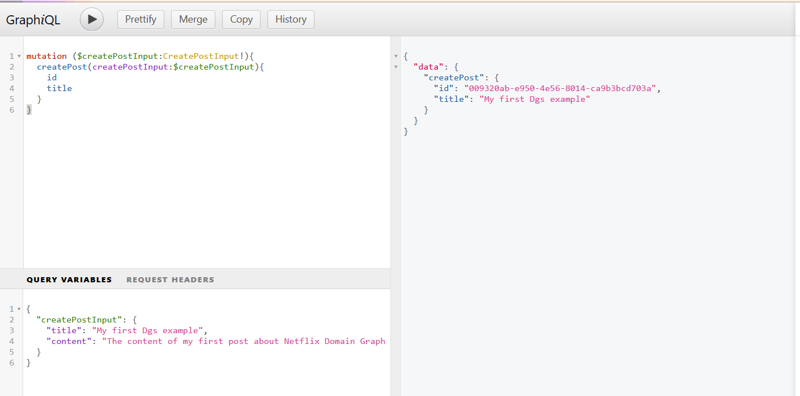
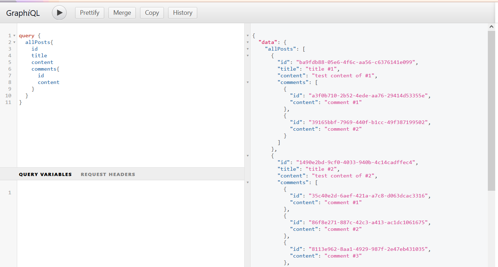
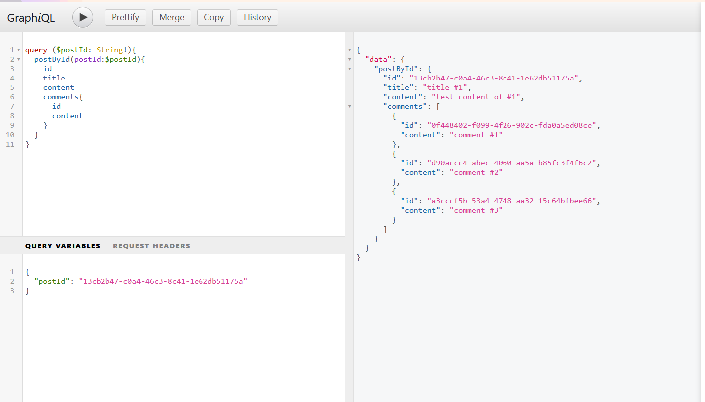

# Getting started with Netflix DGS

Netflix DGS (Domain Graph Service) is the GraphQL server framework that Netflix
open-sourced in 2021 and has run in production since. It gives Spring Boot
developers a schema-first, annotation-driven way to build GraphQL APIs on top
of GraphQL Java.

In this guide you build a small blog API — `Post`, `Author`, and `Comment` —
and, along the way, meet the pieces that make up a DGS application: the schema,
data fetchers, data loaders, error handling, and validation. From there you
extend it to a reactive WebFlux stack, generate types with the DGS codegen
plugin, call the API with the generated client, and accept file uploads.

Every section maps to a working module in the
[spring-graphql-sample](https://github.com/hantsy/spring-graphql-sample)
repository. The code excerpts are trimmed to the parts that matter.

## Prerequisites

- **Java 25** — the examples target Spring Boot 4.1.2 / Spring Framework 7.
- **Docker** — the blog API stores data in PostgreSQL, started with Docker
  Compose.
- **Maven** — optional; every module ships its own Maven Wrapper (`mvnw`).

## The blog domain and schema

DGS is schema-first: you describe the API in the GraphQL Schema Definition
Language (SDL), and DGS wires your Java code to it. The `dgs` module declares
the following schema in `src/main/resources/schema/schema.graphql`:

```graphql
type Post {
    id: ID!
    title: String!
    content: String
    comments: [Comment]
    authorId: String
    author: Author
}

type Author {
    id: ID!
    name: String!
    email: String!
    posts: [Post]
}

type Comment {
    id: ID!
    content: String!
    postId: String!
}

input CreatePostInput {
    title: String!
    content: String!
}

type Query {
    allPosts: [Post!]!
    postById(postId: ID!): Post
}

type Mutation {
    createPost(createPostInput: CreatePostInput!): Post!
}
```

The three object types are the nodes of the graph, `CreatePostInput` is the
argument you pass to create a post, and the `Query` and `Mutation` root types
are the entry points clients call.

## Project setup

The `pom.xml` brings in the DGS platform BOM so all DGS artifacts stay on one
version, then the starter and the usual Spring Boot pieces:

```xml
<properties>
    <java.version>25</java.version>
    <dgs-platform.version>12.1.0</dgs-platform.version>
</properties>

<dependencyManagement>
    <dependencies>
        <dependency>
            <groupId>com.netflix.graphql.dgs</groupId>
            <artifactId>graphql-dgs-platform-dependencies</artifactId>
            <version>${dgs-platform.version}</version>
            <type>pom</type>
            <scope>import</scope>
        </dependency>
    </dependencies>
</dependencyManagement>

<dependencies>
    <dependency>
        <groupId>com.netflix.graphql.dgs</groupId>
        <artifactId>dgs-starter</artifactId>
    </dependency>
    <dependency>
        <groupId>org.springframework.boot</groupId>
        <artifactId>spring-boot-starter-webmvc</artifactId>
    </dependency>
    <dependency>
        <groupId>org.springframework.boot</groupId>
        <artifactId>spring-boot-starter-validation</artifactId>
    </dependency>
    <dependency>
        <groupId>org.springframework.boot</groupId>
        <artifactId>spring-boot-starter-data-jdbc</artifactId>
    </dependency>
    <dependency>
        <groupId>org.postgresql</groupId>
        <artifactId>postgresql</artifactId>
        <scope>runtime</scope>
    </dependency>
    <dependency>
        <groupId>org.projectlombok</groupId>
        <artifactId>lombok</artifactId>
        <scope>provided</scope>
    </dependency>
</dependencies>
```

- `dgs-starter` is the DGS auto-configuration. Since DGS 9 it is built on
  Spring GraphQL, so it also pulls in Spring GraphQL's execution and transport
  support.
- `spring-boot-starter-webmvc` provides the HTTP endpoint.
- `spring-boot-starter-validation` enables Bean Validation on input types.
- `spring-boot-starter-data-jdbc` and the PostgreSQL driver give us a
  `JdbcClient` for persistence.

The data layer is minimal. `schema.sql` creates the tables, and
`spring.sql.init.mode=always` in `application.properties` runs it on startup:

```sql
CREATE TABLE IF NOT EXISTS users (
    id         BIGSERIAL PRIMARY KEY,
    name       VARCHAR(255) NOT NULL,
    email      VARCHAR(255) NOT NULL
);

CREATE TABLE IF NOT EXISTS posts (
    id         BIGSERIAL PRIMARY KEY,
    title      VARCHAR(255),
    content    VARCHAR(255),
    status     VARCHAR(255) DEFAULT 'DRAFT',
    author_id  BIGINT REFERENCES users(id) ON DELETE CASCADE
);

CREATE TABLE IF NOT EXISTS comments (
    id         BIGSERIAL PRIMARY KEY,
    content    VARCHAR(255),
    post_id    BIGINT REFERENCES posts(id) ON DELETE CASCADE
);
```

The repository layer is plain Spring `JdbcClient`. Here is the write path that
`createPost` uses:

```java
@Component
@RequiredArgsConstructor
public class PostRepository {
    private final JdbcClient jdbcClient;

    public Long create(String title, String content, String status, Long authorId) {
        String sql = """
                INSERT INTO posts (title, content, status, author_id)
                VALUES (:title, :content, :status, :author_id)
                """;
        GeneratedKeyHolder keyHolder = new GeneratedKeyHolder();
        this.jdbcClient.sql(sql)
                .param("title", title)
                .param("content", content)
                .param("status", status)
                .param("author_id", authorId)
                .update(keyHolder, "id");
        return keyHolder.getKeyAs(Long.class);
    }
}
```

## Data fetchers

Data fetchers are where the schema meets your Java code. You mark a class with
`@DgsComponent` and its methods with the DGS annotations, which bind a method
to a schema field by name:

```java
@DgsComponent
@RequiredArgsConstructor
public class PostsDataFetcher {
    private final PostService postService;

    @DgsQuery
    public List<Post> allPosts() {
        return this.postService.getAllPosts();
    }

    @DgsQuery
    public Post postById(@InputArgument Long postId) {
        return this.postService.getPostById(postId);
    }

    @DgsData(parentType = "Post", field = "author")
    public CompletableFuture<Author> author(DgsDataFetchingEnvironment dfe) {
        DataLoader<Long, Author> dataLoader = dfe.getDataLoader("authorsLoader");
        Post post = dfe.getSource();
        return dataLoader.load(post.getAuthorId());
    }

    @DgsData(parentType = "Post", field = "comments")
    public CompletableFuture<List<Comment>> comments(DgsDataFetchingEnvironment dfe) {
        DataLoader<Long, List<Comment>> dataLoader = dfe.getDataLoader(CommentsDataLoader.class);
        Post post = dfe.getSource();
        return dataLoader.load(post.getId());
    }

    @DgsMutation
    public Post createPost(@InputArgument("createPostInput") CreatePostInput input) {
        var id = this.postService.createPost(input);
        return this.postService.getPostById(id);
    }
}
```

The annotations, in order of appearance:

- `@DgsComponent` — a Spring stereotype that marks the class as a container of
  data fetchers.
- `@DgsQuery` / `@DgsMutation` — bind a method to a field on the `Query` /
  `Mutation` root type, matched by method name. `allPosts()` serves the
  `allPosts` field.
- `@DgsData(parentType = "Post", field = "author")` — binds a method to a
  nested field on any type. `dfe.getSource()` returns the parent `Post`.
- `@InputArgument` — binds a GraphQL argument to a parameter, coercing it to
  the parameter type. `@InputArgument("createPostInput")` names the argument
  explicitly because the parameter is `input`, not `createPostInput`.

The `author` and `comments` fetchers return `CompletableFuture` and go through
a `DataLoader`; that is the N+1 fix we return to in the
[custom components](#custom-components) section.

The GraphQL types themselves are plain Lombok value objects:

```java
@Data
@Builder
public class Post {
    Long id;
    String title;
    String content;
    List<Comment> comments;
    Long authorId;
    Author author;
}
```

The input type carries Bean Validation constraints, which DGS enforces when you
add `@Valid` to the argument (the `dgs-webflux` module does exactly that):

```java
@Getter
@Setter
@RequiredArgsConstructor
public class CreatePostInput {
    @NotEmpty
    @Length(min = 5, max = 100)
    String title;

    @NotEmpty
    String content;
}
```

A `DataInitializer` bean implements `ApplicationRunner` and seeds a handful of
posts and comments on startup, so there is data to query immediately.

## Build and run

Start the shared PostgreSQL container from the repository root:

```bash
docker compose up -d postgres
```

The `docker-compose.yml` creates a `blogdb` database with user `user` and
password `password`, which matches `application.properties`:

```properties
spring.datasource.url=jdbc:postgresql://localhost/blogdb
spring.datasource.username=user
spring.datasource.password=password
spring.sql.init.mode=always
```

Then run the application:

```bash
cd dgs
./mvnw spring-boot:run
```

On Windows use `mvnw.cmd spring-boot:run`. Once you see the "started
DemoApplication" log line, open
[http://localhost:8080/graphiql](http://localhost:8080/graphiql).

## GraphiQL

DGS ships [GraphiQL](https://github.com/graphql/graphiql), an in-browser IDE
that reads your schema through introspection and provides completion,
documentation, and a query runner. On the left you browse the schema; on the
right you run operations and read the response.

Create a post with the `createPost` mutation:



Then read it back. `allPosts` returns every post, resolving each author and
comment list too:



And fetch one post by id with `postById`:



Because the author and comments live in separate tables, `allPosts` is exactly
where the `DataLoader`s earn their keep — a plain nested fetch would run one
query per post.

## Switching to WebFlux

The `dgs-webflux` module runs the same blog domain on the reactive stack. The
switch is mostly a dependency change:

```xml
<dependency>
    <groupId>org.springframework.boot</groupId>
    <artifactId>spring-boot-starter-webflux</artifactId>
</dependency>
<dependency>
    <groupId>org.springframework.boot</groupId>
    <artifactId>spring-boot-starter-data-r2dbc</artifactId>
</dependency>
<dependency>
    <groupId>org.postgresql</groupId>
    <artifactId>r2dbc-postgresql</artifactId>
    <scope>runtime</scope>
</dependency>
```

`webmvc` becomes `webflux`, and blocking JDBC becomes reactive R2DBC. The
fetchers change their return types to Reactor types — the annotations stay the
same:

```java
@DgsComponent
@Validated
public class PostsDataFetcher {
    private final PostService postService;
    private final AuthorService authorService;

    @DgsQuery
    public Flux<Post> allPosts() {
        return this.postService.getAllPosts();
    }

    @DgsQuery
    public Mono<Post> postById(@InputArgument Long postId) {
        return this.postService.getPostById(postId);
    }

    @DgsMutation
    public Mono<Post> createPost(@InputArgument("createPostInput") @Valid CreatePostInput input) {
        return this.postService.createPost(input).flatMap(id -> this.postService.getPostById(id));
    }

    @DgsMutation
    public Mono<Comment> addComment(@InputArgument("commentInput") @Valid CommentInput input) {
        return this.postService.addComment(input);
    }

    @DgsSubscription
    Publisher<Comment> commentAdded() {
        return postService.commentAdded();
    }
}
```

Two things to notice:

- `@Valid` on the argument turns on Bean Validation for `CreatePostInput`.
- `@DgsSubscription` turns a method that returns a reactive `Publisher` into a
  live subscription — a stream of results pushed to the client, here over
  Server-Sent Events or WebSocket.

This module also adds a second mutation (`addComment`) and demonstrates the
subscription transport, so it is the one to copy when you need real-time
updates.

## Codegen for type safety

So far the types (`Post`, `Author`, `CreatePostInput`) are written by hand. The
`dgs-codegen` module generates them from the schema with the DGS codegen
plugin, so the Java types and the schema cannot drift apart. It also generates
a `DgsConstants` class with the type and field names as constants.

The Maven setup wires the plugin in and adds the generated sources to the build:

```xml
<plugin>
    <groupId>io.github.deweyjose</groupId>
    <artifactId>graphqlcodegen-maven-plugin</artifactId>
    <version>${dgs-codegen-plugin.version}</version>
    <executions>
        <execution>
            <id>dgs-codegen</id>
            <goals><goal>generate</goal></goals>
            <configuration>
                <schemaPaths>
                    <param>${project.basedir}/src/main/resources/schema</param>
                </schemaPaths>
                <packageName>com.example.demo.gql</packageName>
                <generateClientApi>true</generateClientApi>
            </configuration>
        </execution>
    </executions>
</plugin>
```

Because this is the Maven plugin rather than the Gradle one, you also add
`graphql-dgs-codegen-shared-core`, which supplies the base classes of the
generated client API.

With codegen, the schema is richer — it adds a `PostStatus` enum, a
`createdAt` field, custom scalars, and a custom directive:

```graphql
directive @uppercase on FIELD_DEFINITION
scalar LocalDateTime
scalar UUID

type Post {
    id: ID!
    title: String! @uppercase
    content: String
    comments: [Comment]
    status: PostStatus
    createdAt: LocalDateTime
    authorId: String
    author: Author
}

enum PostStatus {
    DRAFT, PENDING_MODERATION, PUBLISHED
}
```

The fetchers now reference the generated constants instead of hard-coded
strings, and the generated types instead of hand-written ones:

```java
@DgsData(
    parentType = DgsConstants.POST.TYPE_NAME,
    field = DgsConstants.POST.Author
)
public CompletableFuture<Author> author(DgsDataFetchingEnvironment dfe) {
    DataLoader<String, Author> dataLoader = dfe.getDataLoader("authorsLoader");
    Post post = dfe.getSource();
    return dataLoader.load(post.getAuthorId());
}
```

`DgsConstants.POST.TYPE_NAME` and `DgsConstants.POST.Author` are generated, so
a schema rename becomes a compile error rather than a silent typo.

## Custom components

DGS's extension points all follow the same pattern: implement an interface,
annotate it with a `@Dgs*` annotation, and DGS registers it. This section
covers the ones you will reach for most often.

### Custom scalars

A custom scalar teaches GraphQL Java how to serialize and parse a value type
that is not one of the five built-in scalars. The `dgs-codegen` module declares
`scalar LocalDateTime` and implements it with `@DgsScalar`:

```java
@DgsScalar(name = "LocalDateTime")
public class LocalDateTimeScalar implements Coercing<LocalDateTime, String> {

    @Override
    public String serialize(Object dataFetcherResult, GraphQLContext ctx, Locale locale) {
        if (dataFetcherResult instanceof LocalDateTime dateTime) {
            return dateTime.format(DateTimeFormatter.ISO_DATE_TIME);
        }
        throw new CoercingSerializeException("Not a valid DateTime");
    }

    @Override
    public LocalDateTime parseLiteral(Value<?> input, CoercedVariables variables,
                                      GraphQLContext ctx, Locale locale) {
        if (input instanceof StringValue value) {
            return LocalDateTime.parse(value.getValue(), DateTimeFormatter.ISO_DATE_TIME);
        }
        throw new CoercingParseLiteralException("Value is not a valid ISO date time");
    }
}
```

`serialize` turns a `LocalDateTime` into the ISO string sent to the client;
`parseValue`/`parseLiteral` do the reverse for input. A `UUIDScalar` does the
same for `java.util.UUID`. The `graphql-dgs-extended-scalars` dependency ships
ready-made scalars for common types if you would rather not write your own.

### Custom directives

A directive decorates a field and can change how it is fetched. The
`@uppercase` directive wraps the field's data fetcher so the returned value is
uppercased:

```java
@DgsDirective(name = "uppercase")
public class UppercaseDirectiveWiring implements SchemaDirectiveWiring {

    @Override
    public GraphQLFieldDefinition onField(SchemaDirectiveWiringEnvironment<GraphQLFieldDefinition> env) {
        var field = env.getElement();
        var parentType = env.getFieldsContainer();
        var coordinates = FieldCoordinates.coordinates(parentType, field.getName());
        var original = env.getCodeRegistry().getDataFetcher(coordinates, field);

        var dataFetcher = DataFetcherFactories.wrapDataFetcher(original, (dfe, value) ->
                value instanceof String s ? s.toUpperCase() : value);

        env.getCodeRegistry().dataFetcher(coordinates, dataFetcher);
        return field;
    }
}
```

Because the schema marks `title: String! @uppercase`, every `title` that comes
back from the server is upper-cased — the directive changed the field's
behavior without touching the fetcher.

### Error handling

When a data fetcher throws, DGS turns the exception into a GraphQL error. You
can take over that mapping with a `DataFetcherExceptionHandler` and, using
DGS's `TypedGraphQLError`, attach a well-known error type and HTTP-like status:

```java
@Component
public class CustomDataFetchingExceptionHandler implements DataFetcherExceptionHandler {
    private final DefaultDataFetcherExceptionHandler defaultHandler =
            new DefaultDataFetcherExceptionHandler();

    @Override
    public CompletableFuture<DataFetcherExceptionHandlerResult> handleException(
            DataFetcherExceptionHandlerParameters handlerParameters) {
        Throwable exception = handlerParameters.getException();
        if (exception instanceof AuthorNotFoundException || exception instanceof PostNotFoundException) {
            GraphQLError error = TypedGraphQLError.newNotFoundBuilder()
                    .message(exception.getMessage())
                    .path(handlerParameters.getPath())
                    .build();
            return CompletableFuture.completedFuture(
                    DataFetcherExceptionHandlerResult.newResult().error(error).build());
        }
        return defaultHandler.handleException(handlerParameters);
    }
}
```

Now a `postById` for a missing id returns a typed `NOT_FOUND` error with a
clear message instead of a generic stack trace. The `dgs-webflux` module goes
one step further and also maps `ConstraintViolationException` to a typed
`BAD_REQUEST`, so validation failures are reported consistently.

### Bean Validation

Input types are plain objects, so you validate them with the Jakarta Bean
Validation annotations you already use in Spring MVC. Add constraints to the
input class:

```java
public class CreatePostInput {
    @NotEmpty
    @Length(min = 5, max = 100)
    String title;

    @NotEmpty
    String content;
}
```

Then mark the argument with `@Valid` (and the class with `@Validated`) as shown
in the WebFlux section. A request with an empty title is rejected before it
reaches your service.

### DataLoaders and the N+1 problem

A naive `author` fetcher would run one query per post — loading ten posts plus
their authors means eleven queries. `@DgsDataLoader` batches and caches the
lookups per request:

```java
@DgsDataLoader(name = "authorsLoader")
@RequiredArgsConstructor
public class AuthorsDataLoader implements BatchLoader<Long, Author> {
    private final AuthorService authorService;

    @Override
    public CompletionStage<List<Author>> load(List<Long> keys) {
        return CompletableFuture.supplyAsync(() -> this.authorService.getAuthorByIdIn(keys));
    }
}
```

Instead of one query per id, the loader collects the keys during the execution
tick and issues a single `WHERE id IN (...)` query. The fetcher looks the
loader up by name and calls `load(key)` — the same pattern you saw in
`PostsDataFetcher`. Use a loader for any nested field backed by a second table
or a remote call.

## Typesafe client

The `dgs-client` module is a small command-line application that calls the
GraphQL API with the client the codegen plugin generated. It is a separate
module from the server: it declares the same schema, enables
`generateClientApi`, and depends on `graphql-dgs-client` and
`spring-boot-starter-restclient`.

The generated client API comes in two halves. A query object holds the
operation, and a projection declares which fields you want:

```java
GraphQLQueryRequest request = new GraphQLQueryRequest(
        new AllPostsGraphQLQuery(),
        new AllPostsProjectionRoot<AuthorProjection<?, ?>, PostProjection<?, ?>>()
                .id().title().content().status().parent()
                .author().id().name().email().parent()
                .comments().id().content().parent()
                .createdAt());

String query = request.serialize();
```

`request.serialize()` produces the GraphQL document. You then execute it with
the DGS client, which rides Spring's `RestClient`:

```java
DgsGraphQLClient client =
        new DgsRestClientGraphQLClient(RestClient.builder().baseUrl(url).build());

DgsGraphQLResponse response = client.executeQuery(query, Map.of());
List<Post> posts = response.extractValueAsObject("allPosts", new TypeRef<List<Post>>() {});
```

The projections are typesafe: you can only select fields that exist on the
type, and `extractValueAsObject` deserializes into the generated `Post`. The
module's test stubs the `/graphql` endpoint with WireMock and verifies the
request body semantically, so the client is exercised without a running server.

## File upload

GraphQL does not define file uploads in the specification, and Spring GraphQL
does not ship one. The `dgs-fileupload` module adds it back with the
[GraphQL multipart request specification](https://github.com/jaydenseric/graphql-multipart-request-spec)
via the
[multipart-spring-graphql](https://github.com/nkonev/multiple-spring-graphql)
library:

```xml
<dependency>
    <groupId>name.nkonev.multipart-spring-graphql</groupId>
    <artifactId>multipart-spring-graphql</artifactId>
    <version>${multipart-spring-graphql.version}</version>
</dependency>
```

The schema declares the `Upload` scalar and uses it in a mutation:

```graphql
scalar Upload

type Mutation {
    upload(file: Upload!): Boolean
    uploadWithDesc(desc: String, file: Upload!): Boolean
    uploads(files: [Upload!]!): Boolean
}
```

In the data fetcher you read the file from the environment rather than via
`@InputArgument`, because a `MultipartFile` cannot be deserialized through the
Jackson object mapper:

```java
@DgsComponent
public class FileUploadMutation {

    @DgsMutation
    public Boolean upload(DgsDataFetchingEnvironment env) {
        var file = (MultipartFile) env.getArgument("file");
        // read file.getInputStream(), file.getOriginalFilename(), file.getContentType()
        return true;
    }
}
```

The multipart parsing happens in the transport layer; your fetcher only sees
the resolved `MultipartFile`.

## Conclusion

You now have a working DGS application and a tour of its extension points. The
base `dgs` module shows the core programming model; `dgs-webflux` the reactive
stack and subscriptions; `dgs-codegen` generated types, custom scalars, and
directives; `dgs-client` the generated client; and `dgs-fileupload` multipart
uploads.

From here:

- Read the [DGS documentation](https://netflix.github.io/dgs/) for federation,
  testing, and the full annotation reference.
- Look at the [dgs-kotlin](https://github.com/hantsy/spring-graphql-sample/tree/master/dgs-kotlin)
  and
  [dgs-kotlin-co](https://github.com/hantsy/spring-graphql-sample/tree/master/dgs-kotlin-co)
  modules for the same domain in Kotlin and coroutines.
- See [DGS or Spring GraphQL?](../intro.md#how-dgs-adopted-spring-graphql) for
  how DGS relates to the Spring team's framework.
