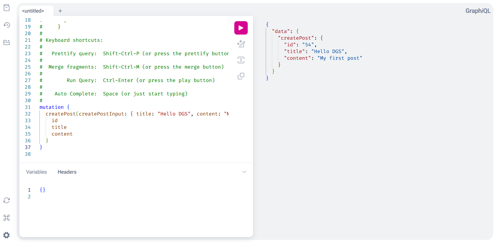
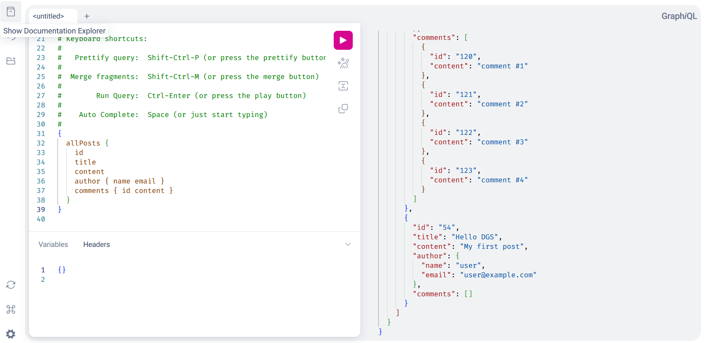
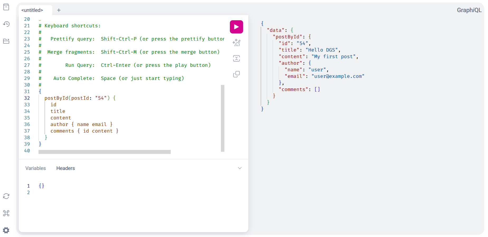
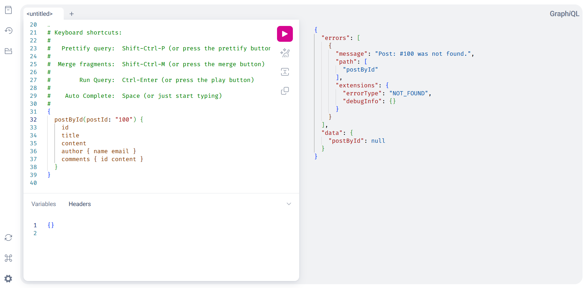

# Building GraphQL APIs with Netflix DGS

This tutorial is for Java developers who know Spring Boot and want to build a
GraphQL API with Netflix DGS (Domain Graph Service). You build a small blog
API for posts, authors, and comments, connect it to PostgreSQL, and try it in
GraphiQL.

Start with the core API, then explore optional extensions: reactive execution
with WebFlux, generated types, custom scalars and directives, a typesafe
client, and file uploads. This guide focuses on a single service; it does not
cover federation or production deployment. The examples correspond to working
modules in the
[spring-graphql-sample repository](https://github.com/hantsy/spring-graphql-sample).
Code excerpts omit package declarations and imports when they are not needed
to understand the step.

## Prerequisites

Before you begin, install or prepare the following:

- Java 25. The examples target Spring Boot 4.1.2 and Spring Framework 7.
- Docker running locally, for PostgreSQL.
- Git, if you want to clone and run the sample repository.

You do not need to install Maven separately; Spring Initializr generates a
Maven Wrapper with the project.

## Step 1: Create a Spring Boot project

Create a Maven project with [Spring Initializr](https://start.spring.io/):

1. Select Java 25 and Spring Boot 4.1.2.
2. Set the group to `com.example` and the artifact to `demo` to match the
   package names in the examples.
3. Add Spring Web, Validation, JDBC API, PostgreSQL Driver, and Lombok.
4. Generate the project, extract it, and open it in your IDE.

**A BOM** (bill of materials) keeps related dependency versions aligned. Add
the DGS BOM to `pom.xml`, then add `dgs-starter` and the Spring Boot
dependencies for web, validation, and JDBC. The relevant parts of the POM
look like this:

```xml
<properties>
    <java.version>25</java.version>
    <dgs-platform.version>12.1.0</dgs-platform.version>
</properties>

<dependencyManagement>
    <dependencies>
        <dependency>
            <groupId>com.netflix.graphql.dgs</groupId>
            <artifactId>graphql-dgs-platform-dependencies</artifactId>
            <version>${dgs-platform.version}</version>
            <type>pom</type>
            <scope>import</scope>
        </dependency>
    </dependencies>
</dependencyManagement>

<dependencies>
    <dependency>
        <groupId>com.netflix.graphql.dgs</groupId>
        <artifactId>dgs-starter</artifactId>
    </dependency>
    <dependency>
        <groupId>org.springframework.boot</groupId>
        <artifactId>spring-boot-starter-webmvc</artifactId>
    </dependency>
    <dependency>
        <groupId>org.springframework.boot</groupId>
        <artifactId>spring-boot-starter-validation</artifactId>
    </dependency>
    <dependency>
        <groupId>org.springframework.boot</groupId>
        <artifactId>spring-boot-starter-data-jdbc</artifactId>
    </dependency>
    <dependency>
        <groupId>org.postgresql</groupId>
        <artifactId>postgresql</artifactId>
        <scope>runtime</scope>
    </dependency>
    <dependency>
        <groupId>org.projectlombok</groupId>
        <artifactId>lombok</artifactId>
        <scope>provided</scope>
    </dependency>
</dependencies>
```

The dependencies serve these roles:

- `dgs-starter` configures DGS and its GraphQL execution support.
- `spring-boot-starter-webmvc` provides the HTTP endpoint.
- `spring-boot-starter-validation` provides Bean Validation.
- `spring-boot-starter-data-jdbc` and the PostgreSQL driver provide
  `JdbcClient` and PostgreSQL connectivity.

## Step 2: Define GraphQL schema

**A GraphQL schema** is the contract that describes which data clients can
read or change and what each operation returns. DGS is schema-first: you write
that contract in the GraphQL Schema Definition Language (SDL), then connect
Java code to its fields.

An **object type** describes data clients can select fields from. An **input
type** describes data clients can pass to an operation. `Query` is the root
type for reads, and `Mutation` is the root type for writes. In SDL, `!` marks
a required value and square brackets mark a list.

Create a `schema.graphql` file in `src/main/resources/schema` and define the
blog types, queries, and mutation:

```graphql
type Post {
    id: ID!
    title: String!
    content: String
    comments: [Comment]
    authorId: String
    author: Author
}

type Author {
    id: ID!
    name: String!
    email: String!
    posts: [Post]
}

type Comment {
    id: ID!
    content: String!
    postId: String!
}

input CreatePostInput {
    title: String!
    content: String!
}

type Query {
    allPosts: [Post!]!
    postById(postId: ID!): Post
}

type Mutation {
    createPost(createPostInput: CreatePostInput!): Post!
}
```

This schema exposes two queries and one mutation. The `Post`, `Author`, and
`Comment` object types describe returned data; `CreatePostInput` describes the
input to `createPost`. The schema also declares `Author.posts`, but the core
example does not implement that reverse relationship. Use `Post.author` in the
queries below; add an `Author.posts` data fetcher before querying the reverse
relationship.

## Step 3: Set up PostgreSQL and persistence

The persistence layer has five parts: a database schema, a local PostgreSQL
instance, Java records that map database rows, repositories that run SQL, and
sample data. Complete these steps before you start the application.

### Create database tables

Create a `schema.sql` file in `src/main/resources`:

```sql
CREATE TABLE IF NOT EXISTS users (
    id         BIGSERIAL PRIMARY KEY,
    name       VARCHAR(255) NOT NULL,
    email      VARCHAR(255) NOT NULL
);

CREATE TABLE IF NOT EXISTS posts (
    id         BIGSERIAL PRIMARY KEY,
    title      VARCHAR(255),
    content    VARCHAR(255),
    status     VARCHAR(255) DEFAULT 'DRAFT',
    author_id  BIGINT REFERENCES users(id) ON DELETE CASCADE
);

CREATE TABLE IF NOT EXISTS comments (
    id         BIGSERIAL PRIMARY KEY,
    content    VARCHAR(255),
    post_id    BIGINT REFERENCES posts(id) ON DELETE CASCADE
);
```

Set `spring.sql.init.mode=always` in `application.properties` so Spring Boot
creates these tables when the application starts:

```properties
spring.sql.init.mode=always
```

### Start PostgreSQL locally

For a standalone project, create a `docker-compose.yml` file in the project
root with a PostgreSQL service. This service uses the same database name and
credentials as the application:

```yaml
services:
  postgres:
    image: postgres:16
    environment:
      POSTGRES_DB: blogdb
      POSTGRES_USER: user
      POSTGRES_PASSWORD: password
    ports:
      - "5432:5432"
```

Add these connection settings to `src/main/resources/application.properties`:

```properties
spring.datasource.url=jdbc:postgresql://localhost/blogdb
spring.datasource.username=user
spring.datasource.password=password
spring.sql.init.mode=always
```

The sample repository already has a shared PostgreSQL service in its root
`docker-compose.yml`; use that file instead of creating another one when you
run the sample.

### Map database rows to Java records

Create a Java record for each table in package `com.example.demo.model`, one
record per file:

```java
// PostEntity.java
public record PostEntity(
        Long id,
        String title,
        String content,
        String status,
        Long authorId
) {

}
// CommentEntity.java
public record CommentEntity(
        Long id,
        String content,
        Long postId
) {
}
// AuthorEntity.java
public record AuthorEntity(
        Long id,
        String name,
        String email
) {

}
```

### Create repositories

Create a `PostRepository` class in package `com.example.demo.repository` to
read and write posts with Spring's `JdbcClient`:

```java
@Component
@RequiredArgsConstructor
public class PostRepository {
    private final JdbcClient jdbcClient;

    public List<PostEntity> findAll() {
        String sql = "SELECT * FROM posts";
        return this.jdbcClient.sql(sql)
                .query(PostRepository::mapPost)
                .list();
    }

    public List<PostEntity> findByAuthorId(Long authorId) {
        String sql = """
                SELECT * FROM posts
                WHERE author_id = :author_id
                """;
        return this.jdbcClient.sql(sql)
                .param("author_id", authorId)
                .query(PostRepository::mapPost)
                .list();
    }

    public PostEntity findById(Long id) {
        String sql = """
                SELECT * FROM posts
                WHERE id = :id
                """;
        return this.jdbcClient.sql(sql)
                .param("id", id)
                .query(PostRepository::mapPost)
                .optional()
                .orElse(null);
    }

    public Long create(String title, String content, String status, Long authorId) {
        String sql = """
                INSERT INTO posts (title, content, status, author_id)
                VALUES (:title, :content, :status, :author_id)
                """;
        GeneratedKeyHolder keyHolder = new GeneratedKeyHolder();
        this.jdbcClient.sql(sql)
                .param("title", title)
                .param("content", content)
                .param("status", status)
                .param("author_id", authorId)
                .update(keyHolder, "id");
        return keyHolder.getKeyAs(Long.class);
    }

    public int deleteAll() {
        String sql = "DELETE FROM posts";
        return this.jdbcClient.sql(sql).update();
    }

    private static PostEntity mapPost(ResultSet rs, int rowNum) throws SQLException {
        return new PostEntity(
                rs.getObject("id", Long.class),
                rs.getString("title"),
                rs.getString("content"),
                rs.getString("status"),
                rs.getObject("author_id", Long.class)
        );
    }
}
```

`PostRepository` uses `JdbcClient` to run SQL and map rows to `PostEntity`.
The `create` method inserts a post and returns the generated id, and `mapPost`
maps a `ResultSet` row to a `PostEntity`.

Create `CommentRepository` and `AuthorRepository` classes in package
`com.example.demo.repository` for the other tables:

```java
// CommentRepository.java
@Component
@RequiredArgsConstructor
public class CommentRepository {
    private final JdbcClient jdbcClient;

    public List<CommentEntity> findAll() {
        String sql = "SELECT * FROM comments";
        return this.jdbcClient.sql(sql)
                .query(CommentRepository::mapComment)
                .list();
    }

    public List<CommentEntity> findByPostId(Long postId) {
        String sql = """
                SELECT * FROM comments
                WHERE post_id = :post_id
                """;
        return this.jdbcClient.sql(sql)
                .param("post_id", postId)
                .query(CommentRepository::mapComment)
                .list();
    }

    public List<CommentEntity> findByPostIdIn(List<Long> postId) {
        String sql = """
                SELECT * FROM comments
                WHERE post_id IN (:post_id)
                """;
        return this.jdbcClient.sql(sql)
                .param("post_id", postId)
                .query(CommentRepository::mapComment)
                .list();
    }

    public Long create(String content, Long postId) {
        String sql = """
                INSERT INTO comments (content, post_id)
                VALUES (:content, :post_id)
                """;
        GeneratedKeyHolder keyHolder = new GeneratedKeyHolder();
        this.jdbcClient.sql(sql)
                .param("content", content)
                .param("post_id", postId)
                .update(keyHolder, "id");
        return keyHolder.getKeyAs(Long.class);
    }

    public int deleteAll() {
        String sql = "DELETE FROM comments";
        return this.jdbcClient.sql(sql).update();
    }

    private static CommentEntity mapComment(ResultSet rs, int rowNum) throws SQLException {
        return new CommentEntity(
                rs.getLong("id"),
                rs.getString("content"),
                rs.getLong("post_id")
        );
    }
}

// AuthorRepository.java
@Component
@RequiredArgsConstructor
public class AuthorRepository {
    private final JdbcClient jdbcClient;

    public List<AuthorEntity> findAll() {
        String sql = "SELECT * FROM users";
        return this.jdbcClient.sql(sql)
                .query(AuthorRepository::mapAuthor)
                .list();
    }

    public AuthorEntity findById(Long id) {
        String sql = """
                SELECT * FROM users
                WHERE id = :id
                """;
        return this.jdbcClient.sql(sql)
                .param("id", id)
                .query(AuthorRepository::mapAuthor)
                .optional()
                .orElse(null);
    }

    public List<AuthorEntity> findByIdIn(List<Long> id) {
        String sql = """
                SELECT * FROM users
                WHERE id IN (:id)
                """;
        return this.jdbcClient.sql(sql)
                .param("id", id)
                .query(AuthorRepository::mapAuthor)
                .list();
    }

    public Long create(String name, String email) {
        String sql = """
                INSERT INTO users (name, email)
                VALUES (:name, :email)
                """;
        GeneratedKeyHolder keyHolder = new GeneratedKeyHolder();
        this.jdbcClient.sql(sql)
                .param("name", name)
                .param("email", email)
                .update(keyHolder, "id");
        return keyHolder.getKeyAs(Long.class);
    }

    public int deleteAll() {
        String sql = "DELETE FROM users";
        return this.jdbcClient.sql(sql).update();
    }

    private static AuthorEntity mapAuthor(ResultSet rs, int rowNum) throws SQLException {
        return new AuthorEntity(
                rs.getLong("id"),
                rs.getString("name"),
                rs.getString("email")
        );
    }
}
```

### Seed sample data

An `ApplicationRunner` runs after Spring starts. Create a `DataInitializer`
class in package `com.example.demo` to seed sample authors, posts, and
comments, so you can query data right away:

```java
@Component
@RequiredArgsConstructor
@Slf4j
public class DataInitializer implements ApplicationRunner {
    final PostRepository posts;
    final CommentRepository comments;
    final AuthorRepository authors;

    @Override
    public void run(ApplicationArguments args) throws Exception {
        log.info("start data initialization...");
        int commentsDel = this.comments.deleteAll();
        int postDel = this.posts.deleteAll();
        int authorsDel = this.authors.deleteAll();

        log.info("deleted rows: authors: {}, comments: {}, posts: {}", authorsDel, commentsDel, postDel);
        var authorId = this.authors.create("user", "user@example.com");
        IntStream.range(1, 5)
                .forEach(
                        i -> {
                            var postId = this.posts.create("Dgs post #" + i, "test content of #" + i, PostStatus.DRAFT.name(), authorId);

                            IntStream.range(1, new Random().nextInt(5) + 1)
                                    .forEach(c -> this.comments.create("comment #" + c, postId));
                        }
                );

        this.posts.findAll().forEach(p -> log.info("post: {}", p));
        this.comments.findAll().forEach(p -> log.info("comment: {}", p));
        this.authors.findAll().forEach(p -> log.info("author: {}", p));
        log.info("done data initialization...");
    }
}
```

The sample initializer deletes existing authors, posts, and comments before it
seeds new rows. Use it only with a disposable local database; do not copy this
cleanup behavior into production.

The persistence layer is ready. Next, create the GraphQL models and connect
them to the repositories through a service and data fetchers.

## Step 4: Model GraphQL types

GraphQL models are the Java objects returned by your data fetchers. Create a
Java class for each schema object type in package `com.example.demo.gql.types`.
Start with `Post`:

```java
@Data
@Builder
@ToString
@Slf4j
public class Post {
    Long id;
    String title;
    String content;
    @Builder.Default
    PostStatus status = PostStatus.DRAFT;
    @Builder.Default
    List<Comment> comments = new ArrayList<>();
    Long authorId;
    Author author;

    public void addComment(Comment comment) {
        comment.setPostId(this.id);
        this.comments.add(comment);
        log.info("post comments: {}", this.comments);
    }
}
```

Create `Author` and `Comment` classes in package `com.example.demo.gql.types`
to represent the remaining schema types.
`PostStatus` is an application enum used to map the stored post status; the
core schema does not expose it. The code-generation extension later adds it to
the GraphQL schema. `CreatePostInput` represents the schema's create-post
input; the `CommentInput` model is used by the WebFlux extension:

```java

// Author.java
@Data
@Builder
@ToString
public class Author {
    Long id;
    String name;
    String email;
}

// Comment.java
@Data
@Builder
@ToString
public class Comment {
    Long id;
    Long postId;
    String content;
}

// CreatePostInput.java
@Getter
@Setter
@ToString
@RequiredArgsConstructor
public class CreatePostInput {
    @NotEmpty
    @Length(min = 5, max = 100)
    String title;

    @NotEmpty
    String content;
}

// CommentInput.java
@Getter
@Setter
@ToString
@RequiredArgsConstructor
public class CommentInput {

    @NotEmpty
    @Length(min = 10, max = 50)
    String content;

    @NotEmpty
    String postId;
}

// PostStatus.java
public enum PostStatus {
    DRAFT, PUBLISHED
}
```

Input types can declare Bean Validation constraints. `@NotEmpty` requires a
value, and `@Length` limits the title. These annotations do not run by
themselves: to validate a GraphQL argument, add `@Valid` to the argument and
`@Validated` to the fetcher class. The WebFlux example later shows this
configuration.

## Step 5: Implement data fetchers

**A data fetcher** resolves a GraphQL schema field. A request enters through a
`Query` or `Mutation` fetcher; DGS also resolves nested fields such as
`Post.author` when a client selects them. Mark the containing class with
`@DgsComponent`, then bind methods to schema fields with DGS annotations.

Create a `PostsDataFetcher` class in package
`com.example.demo.gql.datafetchers`. Use `@DgsQuery` and `@DgsMutation` for
root operations, and `@DgsData` for nested fields.

When a query selects nested fields such as `Post.author`, each field is
resolved for every returned post. **The N+1 problem** occurs when this causes
one extra database or service call per post. A **DataLoader** collects those
lookup keys, batches them, and caches results for the current request. The
following resolver class handles root operations and delegates nested lookups
to DataLoaders:

```java
@DgsComponent
@RequiredArgsConstructor
public class PostsDataFetcher {
    private final PostService postService;

    @DgsQuery
    public List<Post> allPosts() {
        return this.postService.getAllPosts();
    }

    @DgsQuery
    public Post postById(@InputArgument Long postId) {
        return this.postService.getPostById(postId);
    }

    @DgsData(parentType = "Post", field = "author")
    public CompletableFuture<Author> author(DgsDataFetchingEnvironment dfe) {
        DataLoader<Long, Author> dataLoader = dfe.getDataLoader("authorsLoader");
        Post post = dfe.getSource();
        return dataLoader.load(post.getAuthorId());
    }

    @DgsData(parentType = "Post", field = "comments")
    public CompletableFuture<List<Comment>> comments(DgsDataFetchingEnvironment dfe) {
        DataLoader<Long, List<Comment>> dataLoader = dfe.getDataLoader(CommentsDataLoader.class);
        Post post = dfe.getSource();
        return dataLoader.load(post.getId());
    }

    @DgsMutation
    public Post createPost(@InputArgument("createPostInput") CreatePostInput input) {
        var id = this.postService.createPost(input);
        return this.postService.getPostById(id);
    }
}
```

The annotations, in order of appearance:

- `@DgsComponent` — a Spring stereotype that marks the class as a container of
  data fetchers.
- `@DgsQuery` / `@DgsMutation` — bind a method to a field on the `Query` /
  `Mutation` root type, matched by method name. `allPosts()` serves the
  `allPosts` field.
- `@DgsData(parentType = "Post", field = "author")` — binds a method to a
  nested field on any type. `dfe.getSource()` returns the parent `Post`.
- `@InputArgument` — binds a GraphQL argument to a parameter, coercing it to
  the parameter type. `@InputArgument("createPostInput")` names the argument
  explicitly because the parameter is `input`, not `createPostInput`.

### Add service layer

The service layer keeps database access out of your data fetchers. It calls
the repositories and maps database entities to GraphQL models. Create a
`PostService` class in package `com.example.demo.service`:

```java
@Service
@RequiredArgsConstructor
public class PostService {
    private static final Function<PostEntity, Post> POST_MAPPER = p -> Post.builder()
            .id(p.id())
            .title(p.title())
            .content(p.content())
            .status(PostStatus.valueOf(p.status()))
            .authorId(p.authorId())
            .build();
    public static final Function<CommentEntity, Comment> COMMENT_MAPPER = c -> Comment.builder()
            .id(c.id())
            .content(c.content())
            .postId(c.postId())
            .build();
    final PostRepository posts;
    final CommentRepository comments;
    final AuthorRepository authors;

    public List<Post> getAllPosts() {
        return this.posts.findAll()
                .stream()
                .map(POST_MAPPER)
                .toList();
    }

    public Post getPostById(Long id) {
        var postEntity = this.posts.findById(id);
        return Optional.ofNullable(postEntity)
                .map(POST_MAPPER)
                .orElseThrow(() -> new PostNotFoundException(id));
    }

    List<Post> getPostsByAuthorId(Long id) {
        return this.posts.findByAuthorId(id)
                .stream()
                .map(POST_MAPPER)
                .toList();
    }

    public Long createPost(CreatePostInput postInput) {
        var authorId = this.authors.findAll().get(0).id();
        Long id = this.posts.create(postInput.getTitle(), postInput.getContent(), "DRAFT", authorId);
        return id;
    }

    public List<Comment> getCommentsByPostId(Long id) {
        return this.comments.findByPostId(id)
                .stream()
                .map(COMMENT_MAPPER)
                .toList();
    }

    public List<Comment> getCommentsByPostIdIn(Set<Long> ids) {
        return this.comments.findByPostIdIn(new ArrayList<>(ids))
                .stream()
                .map(COMMENT_MAPPER)
                .toList();
    }
}
```

### Batch nested-field lookups

The `authorsLoader` implements a batched lookup. Register it with
`@DgsDataLoader`; DGS gathers keys requested by the field fetchers and passes
them to `load` together. For example, ten posts can load their authors with
one `WHERE id IN (...)` query instead of ten individual queries. Create
`AuthorsDataLoader` and `CommentsDataLoader` classes in package
`com.example.demo.gql.dataloaders`:

```java
@DgsDataLoader(name = "authorsLoader")
@RequiredArgsConstructor
public class AuthorsDataLoader implements BatchLoader<Long, Author> {
    private final AuthorService authorService;

    @Override
    public CompletionStage<List<Author>> load(List<Long> keys) {
        return CompletableFuture.supplyAsync(() -> this.authorService.getAuthorByIdIn(keys));
    }
}
```

In the `author` fetcher above, `getDataLoader("authorsLoader")` retrieves this
loader and `load(post.getAuthorId())` queues the lookup. Use the same pattern
for nested fields backed by another table or a remote call.

The `comments` fetcher is different because each key maps to a *list* of
comments. DGS provides `MappedBatchLoader` for exactly this case; it returns a
map from key to value. `CommentsDataLoader` loads all comments for the
requested posts and groups them by post id:

```java
@DgsDataLoader(name = "comments")
@RequiredArgsConstructor
@Slf4j
public class CommentsDataLoader implements MappedBatchLoader<Long, List<Comment>> {
    final PostService postService;

    @Override
    public CompletionStage<Map<Long, List<Comment>>> load(Set<Long> keys) {
        List<Comment> comments = this.postService.getCommentsByPostIdIn(keys);

        Map<Long, List<Comment>> mappedComments = new HashMap<>();
        keys.forEach(
                k -> mappedComments.put(k, comments
                        .stream()
                        .filter(c -> c.getPostId().equals(k)).toList())
        );
        log.info("mapped comments: {}", mappedComments);
        return CompletableFuture.supplyAsync(() -> mappedComments);
    }
}
```

## Step 6: Handle errors

**Error handling** converts exceptions thrown during field resolution into
errors in the GraphQL response. Implement `DataFetcherExceptionHandler` to
choose how known exceptions map to errors, while delegating unexpected ones to
the default handler. DGS's `TypedGraphQLError` can attach a well-known error
type such as `NOT_FOUND`. Create a `CustomDataFetchingExceptionHandler` class
in package `com.example.demo.gql`:

```java
@Component
public class CustomDataFetchingExceptionHandler implements DataFetcherExceptionHandler {
    private final DefaultDataFetcherExceptionHandler defaultHandler =
            new DefaultDataFetcherExceptionHandler();

    @Override
    public CompletableFuture<DataFetcherExceptionHandlerResult> handleException(
            DataFetcherExceptionHandlerParameters handlerParameters) {
        Throwable exception = handlerParameters.getException();
        if (exception instanceof AuthorNotFoundException || exception instanceof PostNotFoundException) {
            GraphQLError error = TypedGraphQLError.newNotFoundBuilder()
                    .message(exception.getMessage())
                    .path(handlerParameters.getPath())
                    .build();
            return CompletableFuture.completedFuture(
                    DataFetcherExceptionHandlerResult.newResult().error(error).build());
        }
        return defaultHandler.handleException(handlerParameters);
    }
}
```

Now a `postById` request for a missing id returns a typed `NOT_FOUND` error
with a clear message. The `dgs-webflux` module also maps
`ConstraintViolationException` to a typed `BAD_REQUEST`, so validation
failures are reported consistently.

## Step 7: Run application

Start PostgreSQL and the application. The following steps use the checked-in
sample; if you created a standalone project, run Docker Compose and its Maven
Wrapper from that project's root directory:

1. From the repository root, start the shared PostgreSQL container:

    ```bash
    docker compose up -d postgres
    ```

    The `docker-compose.yml` creates a `blogdb` database with user `user` and
    password `password`, matching `application.properties`.

2. Start the DGS application:

    ```bash
    cd dgs
    ./mvnw spring-boot:run
    ```

    On Windows, run `mvnw.cmd spring-boot:run` from the `dgs` directory. For
    a standalone project, omit `cd dgs`.

When the `Started DemoApplication` log line appears, the server is ready.

Open `http://localhost:8080/graphiql` in your browser to run a GraphQL
operation. The server provides GraphiQL at this path.

## Step 8: Test APIs in GraphiQL

**GraphiQL** is an in-browser GraphQL IDE. It reads the schema through
introspection and provides field completion, schema documentation, and a query
runner. The schema explorer is on the left; use the operation editor and
response panel to try the API.

### Create a post

A **mutation** changes server-side data. Paste this operation into the editor
and run it to create a post and return its id, title, and content:

```graphql
mutation {
  createPost(createPostInput: { title: "Hello DGS", content: "My first post" }) {
    id
    title
    content
  }
}
```



GraphiQL should show the new post's id, title, and content. Next, list posts
and check that the new post appears with its author and comments.

### List posts

A **query** reads data without changing it. Paste this operation into the
editor and run it. `allPosts` returns every post, and the nested selections
request each post's author and comments:

```graphql
{
  allPosts {
    id
    title
    content
    author { name email }
    comments { id content }
  }
}
```



Because the author and comments live in separate tables, `allPosts` is exactly
where the `DataLoader`s earn their keep — a plain nested fetch would run one
query per post.

### Fetch one post

Use `postById` to request one post by id. Replace `1` with an id from the
`allPosts` result above; GraphQL returns only the fields in the selection set:

```graphql
{
  postById(postId: "1") {
    id
    title
    content
    author { name email }
    comments { id content }
  }
}
```



### Fetch a non-existent post

Requesting a post that does not exist still returns `data`, but `postById` is
`null`, and the response includes an `errors` entry with the message and a
`NOT_FOUND` error type. Replace `1000` with an id that has no matching post,
then run the query:

```graphql
{
  postById(postId: "1000") {
    id
    title
    content
    author { name email }
    comments { id content }
  }
}
```



To compare this walkthrough with runnable code, explore the
[`dgs` module](https://github.com/hantsy/spring-graphql-sample/tree/master/dgs).
The [`dgs-codegen` module](https://github.com/hantsy/spring-graphql-sample/tree/master/dgs-codegen)
shows the generated-type variant, and the
[`dgs-webflux` module](https://github.com/hantsy/spring-graphql-sample/tree/master/dgs-webflux)
includes reactive validation and typed error handling.

## Switch to WebFlux

**WebFlux** is Spring's reactive web stack. **R2DBC** provides reactive
relational database access, unlike the blocking JDBC API used above. The
`dgs-webflux` module keeps the same domain and schema but replaces the
servlet/JDBC dependencies with WebFlux and R2DBC. Replace the MVC and JDBC
dependencies with these:

```xml
<dependency>
    <groupId>org.springframework.boot</groupId>
    <artifactId>spring-boot-starter-webflux</artifactId>
</dependency>
<dependency>
    <groupId>org.springframework.boot</groupId>
    <artifactId>spring-boot-starter-data-r2dbc</artifactId>
</dependency>
<dependency>
    <groupId>org.postgresql</groupId>
    <artifactId>r2dbc-postgresql</artifactId>
    <scope>runtime</scope>
</dependency>
```

Make the same change in your application: replace `webmvc` with `webflux` and
JDBC with R2DBC. You must also update the repository and service layers to use
reactive database operations; changing dependencies alone does not make
blocking JDBC code reactive. Fetchers then return Reactor's `Mono` (zero or
one value) or `Flux` (a stream of values); the DGS annotations stay the same.
The fetcher methods then look like this:

```java
@DgsComponent
@Validated
public class PostsDataFetcher {
    private final PostService postService;
    private final AuthorService authorService;

    @DgsQuery
    public Flux<Post> allPosts() {
        return this.postService.getAllPosts();
    }

    @DgsQuery
    public Mono<Post> postById(@InputArgument Long postId) {
        return this.postService.getPostById(postId);
    }

    @DgsMutation
    public Mono<Post> createPost(@InputArgument("createPostInput") @Valid CreatePostInput input) {
        return this.postService.createPost(input).flatMap(id -> this.postService.getPostById(id));
    }

    @DgsMutation
    public Mono<Comment> addComment(@InputArgument("commentInput") @Valid CommentInput input) {
        return this.postService.addComment(input);
    }

    @DgsSubscription
    Publisher<Comment> commentAdded() {
        return postService.commentAdded();
    }
}
```

This example adds input validation and a subscription:

- `@Valid` on the argument turns on Bean Validation for `CreatePostInput`.
- `@DgsSubscription` turns a method that returns a reactive `Publisher` into a
  live subscription — a stream of results pushed to the client, here over
  Server-Sent Events or WebSocket.

This module also adds a second mutation (`addComment`) and demonstrates the
subscription transport, so it is the one to copy when you need real-time
updates.

To explore the reactive version, see the
[`dgs-webflux` module](https://github.com/hantsy/spring-graphql-sample/tree/master/dgs-webflux).

## Generate types from schema

**Code generation** creates Java types and constants from the GraphQL schema,
reducing the chance that Java code and schema names drift apart. The
`dgs-codegen` module uses the DGS codegen Maven plugin to generate
`Post`, `Author`, `CreatePostInput`, and a `DgsConstants` class.

To try it, set the plugin version in `pom.xml`:

```xml
<properties>
    <dgs-codegen-plugin.version>3.10.2</dgs-codegen-plugin.version>
</properties>
```

Add the codegen plugin under `build/plugins`. Point `schemaPaths` at your SDL
files and choose the generated Java package:

```xml
<plugin>
    <groupId>io.github.deweyjose</groupId>
    <artifactId>graphqlcodegen-maven-plugin</artifactId>
    <version>${dgs-codegen-plugin.version}</version>
    <executions>
        <execution>
            <id>dgs-codegen</id>
            <goals><goal>generate</goal></goals>
            <configuration>
                <schemaPaths>
                    <param>${project.basedir}/src/main/resources/schema</param>
                </schemaPaths>
                <packageName>com.example.demo.gql</packageName>
                <generateClientApi>true</generateClientApi>
            </configuration>
        </execution>
    </executions>
</plugin>
```

The Maven plugin does not register its output directory as a source root.
Add `build-helper-maven-plugin` so Maven compiles the generated files:

```xml
<plugin>
    <groupId>org.codehaus.mojo</groupId>
    <artifactId>build-helper-maven-plugin</artifactId>
    <executions>
        <execution>
            <id>add-dgs-source</id>
            <phase>generate-sources</phase>
            <goals>
                <goal>add-source</goal>
            </goals>
            <configuration>
                <sources>
                    <source>${project.build.directory}/generated-sources</source>
                </sources>
            </configuration>
        </execution>
    </executions>
</plugin>
```

If you generate the client API, add `graphql-dgs-codegen-shared-core`; it
provides base classes used by the generated client. The Maven plugin does not
add this dependency automatically. Use the version property from the sample
POM or set the version shown here:

```xml
<dependency>
    <groupId>com.netflix.graphql.dgs.codegen</groupId>
    <artifactId>graphql-dgs-codegen-shared-core</artifactId>
    <version>8.8.0</version>
</dependency>
```

Run `./mvnw compile` from the module root. Maven generates the Java types and
compiles them with your application code.

The generated types follow the schema. This version adds an enum, a timestamp,
and two concepts used later in the tutorial:

```graphql
directive @uppercase on FIELD_DEFINITION
scalar LocalDateTime
scalar UUID

type Post {
    id: ID!
    title: String! @uppercase
    content: String
    comments: [Comment]
    status: PostStatus
    createdAt: LocalDateTime
    authorId: String
    author: Author
}

enum PostStatus {
    DRAFT, PENDING_MODERATION, PUBLISHED
}
```

An **enum** restricts a field to a known set of values. A **scalar** is a
single value such as a string or timestamp. A **directive** is metadata on a
schema element that can alter behavior; here, `@uppercase` decorates the
`title` field.

The fetchers now reference the generated constants instead of hard-coded
strings, and the generated types instead of hand-written ones:

```java
@DgsData(
    parentType = DgsConstants.POST.TYPE_NAME,
    field = DgsConstants.POST.Author
)
public CompletableFuture<Author> author(DgsDataFetchingEnvironment dfe) {
    DataLoader<String, Author> dataLoader = dfe.getDataLoader("authorsLoader");
    Post post = dfe.getSource();
    return dataLoader.load(post.getAuthorId());
}
```

`DgsConstants.POST.TYPE_NAME` and `DgsConstants.POST.Author` are generated, so
a schema rename becomes a compile error rather than a silent typo.

For a complete code-generation setup, explore the
[`dgs-codegen` module](https://github.com/hantsy/spring-graphql-sample/tree/master/dgs-codegen).

## Custom scalars

A **scalar** is a leaf value in a GraphQL response: clients select it directly
but cannot request subfields from it. GraphQL has built-in scalars such as
`String` and `Int`; a **custom scalar** adds a domain-specific value type.
The schema in the code-generation section declares `LocalDateTime`. Register
a coercer with `@DgsScalar` to convert between Java values and the string
representation sent over GraphQL. Implement serialization and both input
parsing paths:

```java
@DgsScalar(name = "LocalDateTime")
public class LocalDateTimeScalar implements Coercing<LocalDateTime, String> {

    @Override
    public String serialize(Object dataFetcherResult, GraphQLContext ctx, Locale locale) {
        if (dataFetcherResult instanceof LocalDateTime dateTime) {
            return dateTime.format(DateTimeFormatter.ISO_DATE_TIME);
        }
        throw new CoercingSerializeException("Not a valid DateTime");
    }

    @Override
    public LocalDateTime parseValue(Object input, GraphQLContext ctx, Locale locale) {
        if (input instanceof String value) {
            return LocalDateTime.parse(value, DateTimeFormatter.ISO_DATE_TIME);
        }
        throw new CoercingParseValueException("Value is not a valid ISO date time");
    }

    @Override
    public LocalDateTime parseLiteral(Value<?> input, CoercedVariables variables,
                                      GraphQLContext ctx, Locale locale) {
        if (input instanceof StringValue value) {
            return LocalDateTime.parse(value.getValue(), DateTimeFormatter.ISO_DATE_TIME);
        }
        throw new CoercingParseLiteralException("Value is not a valid ISO date time");
    }
}
```

`serialize` converts the Java value to an ISO string for the response.
`parseValue` handles variables, and `parseLiteral` handles values written
directly in a GraphQL document. A `UUIDScalar` follows the same pattern for
`java.util.UUID`. The checked-in `dgs-codegen` scalar accepts a
`LocalDateTime` object in `parseValue`; the string parsing shown here is needed
for standard ISO date-time strings in GraphQL JSON variables. The
`graphql-dgs-extended-scalars` dependency also provides scalars for common
types.

See the
[`dgs-codegen` module](https://github.com/hantsy/spring-graphql-sample/tree/master/dgs-codegen)
for a working custom-scalar example.

## Custom directives

A **directive** is an annotation in the schema that adds behavior to a type,
field, or argument. The schema already declares `@uppercase` for fields.
Register its behavior by implementing `SchemaDirectiveWiring` and wrapping the
field's data fetcher:

```java
@DgsDirective(name = "uppercase")
public class UppercaseDirectiveWiring implements SchemaDirectiveWiring {

    @Override
    public GraphQLFieldDefinition onField(SchemaDirectiveWiringEnvironment<GraphQLFieldDefinition> env) {
        var field = env.getElement();
        var parentType = env.getFieldsContainer();
        var coordinates = FieldCoordinates.coordinates(parentType, field.getName());
        var original = env.getCodeRegistry().getDataFetcher(coordinates, field);

        var dataFetcher = DataFetcherFactories.wrapDataFetcher(original, (dfe, value) ->
                value instanceof String s ? s.toUpperCase() : value);

        env.getCodeRegistry().dataFetcher(coordinates, dataFetcher);
        return field;
    }
}
```

Because the schema marks `title: String! @uppercase`, every `title` that comes
back from the server is upper-cased — the directive changed the field's
behavior without touching the fetcher.

The [`dgs-codegen` module](https://github.com/hantsy/spring-graphql-sample/tree/master/dgs-codegen)
also includes a working custom-directive example.

## Typesafe client

**A typesafe GraphQL client** builds operations and field selections using
generated Java classes rather than hand-written query strings. Reuse the DGS
codegen Maven plugin from the previous section and set `generateClientApi` to
`true` to generate the client API alongside the schema types. Add
`graphql-dgs-client` and `spring-boot-starter-restclient` to build and execute
client requests.

Add these version properties and import the DGS bill of materials (BOM) in
`pom.xml`:

```xml
<properties>
    <dgs-platform.version>12.1.0</dgs-platform.version>
    <dgs-codegen-plugin.version>3.10.2</dgs-codegen-plugin.version>
    <dgs-codegen-core.version>8.8.0</dgs-codegen-core.version>
</properties>

<dependencyManagement>
    <dependencies>
        <dependency>
            <groupId>com.netflix.graphql.dgs</groupId>
            <artifactId>graphql-dgs-platform-dependencies</artifactId>
            <version>${dgs-platform.version}</version>
            <type>pom</type>
            <scope>import</scope>
        </dependency>
    </dependencies>
</dependencyManagement>
```

Add the generated-client support library, DGS client, and Spring HTTP client
dependencies. The sample also includes WebMVC and the Jackson Kotlin module:

```xml
<dependencies>
    <dependency>
        <groupId>com.netflix.graphql.dgs.codegen</groupId>
        <artifactId>graphql-dgs-codegen-shared-core</artifactId>
        <version>${dgs-codegen-core.version}</version>
    </dependency>
    <dependency>
        <groupId>com.netflix.graphql.dgs</groupId>
        <artifactId>graphql-dgs-client</artifactId>
    </dependency>
    <dependency>
        <groupId>tools.jackson.module</groupId>
        <artifactId>jackson-module-kotlin</artifactId>
    </dependency>
    <dependency>
        <groupId>org.springframework.boot</groupId>
        <artifactId>spring-boot-starter-webmvc</artifactId>
    </dependency>
    <dependency>
        <groupId>org.springframework.boot</groupId>
        <artifactId>spring-boot-starter-restclient</artifactId>
    </dependency>
</dependencies>
```

Configure the Maven code-generation plugin to read the schema and generate the
client API. Register its generated source directory so Maven compiles those
classes:

```xml
<build>
    <plugins>
        <plugin>
            <groupId>io.github.deweyjose</groupId>
            <artifactId>graphqlcodegen-maven-plugin</artifactId>
            <version>${dgs-codegen-plugin.version}</version>
            <executions>
                <execution>
                    <id>dgs-codegen</id>
                    <goals>
                        <goal>generate</goal>
                    </goals>
                    <configuration>
                        <schemaPaths>
                            <param>${project.basedir}/src/main/resources/schema</param>
                        </schemaPaths>
                        <packageName>com.example.demo.gql</packageName>
                        <generateClientApi>true</generateClientApi>
                    </configuration>
                </execution>
            </executions>
        </plugin>
        <plugin>
            <groupId>org.codehaus.mojo</groupId>
            <artifactId>build-helper-maven-plugin</artifactId>
            <executions>
                <execution>
                    <id>add-dgs-source</id>
                    <phase>generate-sources</phase>
                    <goals>
                        <goal>add-source</goal>
                    </goals>
                    <configuration>
                        <sources>
                            <source>${project.build.directory}/generated-sources</source>
                        </sources>
                    </configuration>
                </execution>
            </executions>
        </plugin>
    </plugins>
</build>
```

From the client module directory, run `./mvnw generate-sources` (or
`mvnw.cmd generate-sources` on Windows) to generate the Java classes before
building the client.

The generated client API has two parts. A query object identifies the
operation, while a projection describes the fields requested in the selection
set. Build a request like this:

```java
GraphQLQueryRequest request = new GraphQLQueryRequest(
        new AllPostsGraphQLQuery(),
        new AllPostsProjectionRoot<AuthorProjection<?, ?>, PostProjection<?, ?>>()
                .id().title().content().status().parent()
                .author().id().name().email().parent()
                .comments().id().content().parent()
                .createdAt());

String query = request.serialize();
```

`request.serialize()` produces the GraphQL document. You then execute it with
the DGS client, which rides Spring's `RestClient`:

```java
DgsGraphQLClient client =
        new DgsRestClientGraphQLClient(RestClient.builder().baseUrl(url).build());

DgsGraphQLResponse response = client.executeQuery(query, Map.of());
List<Post> posts = response.extractValueAsObject("allPosts", new TypeRef<List<Post>>() {});
```

The projections are typesafe: you can only select fields that exist on the
type, and `extractValueAsObject` deserializes into the generated `Post`. The
module's test stubs the `/graphql` endpoint with WireMock and verifies the
request body semantically, so the client is exercised without a running server.

For a runnable example, explore the repository's
[`dgs-client` module](https://github.com/hantsy/spring-graphql-sample/tree/master/dgs-client),
a separate command-line application that declares the same schema and
exercises the generated client.

## File upload

**File upload** is not defined by the GraphQL specification, so applications
need a transport convention to send files alongside GraphQL operations. The
`dgs-fileupload` module uses the GraphQL multipart request specification,
implemented for Spring GraphQL by the `multipart-spring-graphql` library.
Add the library version to `pom.xml`:

```xml
<properties>
    <multipart-spring-graphql.version>2.1.0</multipart-spring-graphql.version>
</properties>
```

Then add the dependency:

```xml
<dependency>
    <groupId>name.nkonev.multipart-spring-graphql</groupId>
    <artifactId>multipart-spring-graphql</artifactId>
    <version>${multipart-spring-graphql.version}</version>
</dependency>
```

Next, declare an `Upload` scalar and use it in a mutation. The scalar represents
the uploaded file in the GraphQL schema:

```graphql
scalar Upload

type Mutation {
    upload(file: Upload!): Boolean
    uploadWithDesc(desc: String, file: Upload!): Boolean
    uploads(files: [Upload!]!): Boolean
}
```

Finally, read the upload from the data-fetching environment rather than
`@InputArgument`. A `MultipartFile` is supplied by the multipart transport
and cannot be deserialized from a normal GraphQL input object by Jackson:

```java
@DgsComponent
public class FileUploadMutation {

    @DgsMutation
    public Boolean upload(DgsDataFetchingEnvironment env) {
        var file = (MultipartFile) env.getArgument("file");
        // read file.getInputStream(), file.getOriginalFilename(), file.getContentType()
        return true;
    }
}
```

The multipart parsing happens in the transport layer; your fetcher only sees
the resolved `MultipartFile`.

The sample reads and logs the file's metadata and text content; it does not
store the file. Add your own storage and input checks before using uploads in
an application.

References: [GraphQL multipart request specification](https://github.com/jaydenseric/graphql-multipart-request-spec) and [multipart-spring-graphql](https://github.com/nkonev/multiple-spring-graphql).

For a runnable upload example, explore the
[`dgs-fileupload` module](https://github.com/hantsy/spring-graphql-sample/tree/master/dgs-fileupload).

## Testing

Test a DGS application in layers, from fastest and most isolated to the full
wire. First test the data fetchers in process with the service layer mocked,
then the repositories against a real PostgreSQL, and finally the whole
application over HTTP. A fourth technique — stubbing a remote endpoint with
WireMock — tests your GraphQL *client*.

### Test data fetchers

`@EnableDgsTest` enables DGS test support, and `DgsQueryExecutor` runs a
GraphQL operation directly against the schema without starting an HTTP server.
Mock the service layer so the test focuses on the fetcher and its GraphQL
response. Add `dgs-starter-test` with test scope to the server module:

```xml
<dependencies>
    <dependency>
        <groupId>com.netflix.graphql.dgs</groupId>
        <artifactId>dgs-starter-test</artifactId>
        <scope>test</scope>
    </dependency>
    <dependency>
        <groupId>org.springframework.boot</groupId>
        <artifactId>spring-boot-starter-test</artifactId>
        <scope>test</scope>
    </dependency>
</dependencies>
```

Import the fetcher into a minimal test configuration and replace its service
with a mock:

```java
@EnableDgsTest
@SpringBootTest(classes = PostsQueryTest.TestConfig.class)
class PostsQueryTest {
    @Autowired
    DgsQueryExecutor executor;

    @MockitoBean
    PostService postService;

    @Configuration
    @Import(PostsDataFetcher.class)
    static class TestConfig {
    }

    @Test
    void allPosts() {
        when(postService.getAllPosts()).thenReturn(List.of(
                Post.builder().id(1L).title("DGS test").content("Example").build()
        ));

        List<String> titles = executor.executeAndExtractJsonPath(
                "{ allPosts { title content } }",
                "data.allPosts[*].title");

        assertThat(titles).containsExactly("DGS test");
    }
}
```

Because the service is mocked, this test needs no database and no
`TestcontainersConfiguration`. Pass variables as a `Map` when testing
arguments, and use `executor.execute(...)` — which returns the full result —
instead of `executeAndExtractJsonPath` when you need to inspect GraphQL errors.

The same test runs unchanged on the reactive stack. Swap the executor for
`DgsReactiveQueryExecutor`, which returns Reactor `Mono`/`Flux` instead of
plain values, and assert the stream with `StepVerifier`:

```java
Mono<List<String>> titles = executor.executeAndExtractJsonPath(
        "{ allPosts { title content } }",
        "data.allPosts[*].title");

StepVerifier.create(titles)
        .consumeNextWith(it -> assertThat(it).containsExactly("DGS test"))
        .verifyComplete();
```

The sample modules exercise this pattern in different ways:

- [`dgs`](https://github.com/hantsy/spring-graphql-sample/tree/master/dgs)
  tests the query and mutation fetchers and their error responses.
- [`dgs-codegen`](https://github.com/hantsy/spring-graphql-sample/tree/master/dgs-codegen)
  tests generated operations, validation, custom scalars, and directives.
- [`dgs-fileupload`](https://github.com/hantsy/spring-graphql-sample/tree/master/dgs-fileupload)
  tests the `Upload` scalar with `MockMultipartFile`.
- [`dgs-webflux`](https://github.com/hantsy/spring-graphql-sample/tree/master/dgs-webflux)
  tests reactive fetchers and subscriptions with `DgsReactiveQueryExecutor`.

### Test repositories against a database

Fetcher tests mock the data access, so they never touch a database. To verify
the repositories themselves, run them against a real PostgreSQL with
Testcontainers. Use a full `@SpringBootTest` — it component-scans the
repositories, so you can inject them directly — and add
`@Import(TestcontainersConfiguration.class)` for the database connection:

```java
@SpringBootTest
@Import(TestcontainersConfiguration.class)
@Transactional
class RepositoryTests {

    @Autowired
    PostRepository posts;

    @Autowired
    CommentRepository comments;

    @Autowired
    AuthorRepository authors;

    private Long newAuthor() {
        return authors.create("test user", "test@example.com");
    }

    private Long newPost(String title) {
        return newPost(newAuthor(), title);
    }

    private Long newPost(Long authorId, String title) {
        return posts.create(title, title + " content", "DRAFT", authorId);
    }

    private Long newComment(Long postId, String content) {
        return comments.create(content, postId);
    }

    @Test
    void createAndFindPostById() {
        var postId = newPost("test title");

        var post = posts.findById(postId);
        assertThat(post.title()).isEqualTo("test title");
    }
}
```

The `newAuthor`, `newPost`, and `newComment` helpers make it easy to set up
the foreign-key relations in each test. `TestcontainersConfiguration` is a
`@TestConfiguration` whose `@Bean @ServiceConnection PostgreSQLContainer`
supplies the `DataSource`; `spring.sql.init.mode=always` runs `schema.sql`
against it, and `@Transactional` rolls back each test. Because the application
seeds sample data on startup, tests that read a whole table assert with
`contains` rather than an exact count. The
[`dgs`](https://github.com/hantsy/spring-graphql-sample/tree/master/dgs) module
has a single `RepositoryTests` class; the database-backed suites need Docker
running.

### Test over HTTP

Component and repository tests never exercise the transport. To verify the
GraphQL-over-HTTP endpoint, start the application on a random port and call
`/graphql`. `DgsRestClientGraphQLClient` sends requests with Spring's blocking
`RestClient`; the
[`dgs`](https://github.com/hantsy/spring-graphql-sample/tree/master/dgs) and
[`dgs-codegen`](https://github.com/hantsy/spring-graphql-sample/tree/master/dgs-codegen)
integration tests use it:

```java
@SpringBootTest(webEnvironment = SpringBootTest.WebEnvironment.RANDOM_PORT)
@Import(TestcontainersConfiguration.class)
class IntegrationTests {

    @LocalServerPort
    int port;

    @Test
    void createPostOverHttp() {
        var client = new DgsRestClientGraphQLClient(
                RestClient.builder().baseUrl("http://localhost:" + port + "/graphql").build());
        var query = """
                mutation createPost($input: CreatePostInput!) {
                    createPost(createPostInput: $input) { title }
                }
                """;
        var variables = Map.of("input", Map.of(
                "title", "test title",
                "content", "test content"));

        var response = client.executeQuery(query, variables);
        String title = response.extractValueAsObject("createPost.title", String.class);

        assertThat(title).isEqualTo("test title");
    }
}
```

On the reactive stack, use `DgsWebClientGraphQLClient`, which rides Spring's
`WebClient` and returns `Mono`/`Flux`. Verify the result with `StepVerifier`:

```java
var client = new DgsWebClientGraphQLClient(
        WebClient.create("http://localhost:" + port + "/graphql"));

var result = client.reactiveExecuteQuery(query, variables)
        .map(response -> response.extractValueAsObject("createPost", Post.class));

StepVerifier.create(result)
        .consumeNextWith(post -> assertThat(post.getTitle()).isEqualTo("test title"))
        .verifyComplete();
```

The
[`dgs-webflux`](https://github.com/hantsy/spring-graphql-sample/tree/master/dgs-webflux)
integration test uses the reactive client.

### Mock remote GraphQL APIs

To test a client that calls a third-party GraphQL API, point it at a local
WireMock server instead of making a network request. The
[`dgs-client`](https://github.com/hantsy/spring-graphql-sample/tree/master/dgs-client)
module uses WireMock with a GraphQL body matcher, which compares operations
without depending on whitespace or field order.

Add these test dependencies to the client module:

```xml
<properties>
    <wiremock.version>3.13.2</wiremock.version>
    <wiremock-graphql-extension.version>0.9.0</wiremock-graphql-extension.version>
</properties>

<dependencies>
    <dependency>
        <groupId>org.springframework.boot</groupId>
        <artifactId>spring-boot-starter-test</artifactId>
        <scope>test</scope>
    </dependency>
    <dependency>
        <groupId>org.wiremock</groupId>
        <artifactId>wiremock-standalone</artifactId>
        <version>${wiremock.version}</version>
        <scope>test</scope>
    </dependency>
    <dependency>
        <groupId>io.github.nilwurtz</groupId>
        <artifactId>wiremock-graphql-extension</artifactId>
        <version>${wiremock-graphql-extension.version}</version>
        <scope>test</scope>
    </dependency>
</dependencies>
```

Stub the remote operation and direct the DGS HTTP client to WireMock's local
URL:

```java
String query = "{ allPosts { id title } }";
WireMockServer wireMock = new WireMockServer(
        options().dynamicPort().extensions(new GraphqlBodyMatcher()));
wireMock.start();
try {
    wireMock.stubFor(post(urlEqualTo("/graphql"))
            .andMatching(GraphqlBodyMatcher.extensionName,
                    GraphqlBodyMatcher.parameters(query, Map.of()))
            .willReturn(okJson("""
                    {"data":{"allPosts":[{"id":"1","title":"Mocked post"}]}}
                    """)));

    DgsGraphQLClient client = new DgsRestClientGraphQLClient(
            RestClient.builder().baseUrl(wireMock.url("/graphql")).build());
    DgsGraphQLResponse response = client.executeQuery(query, Map.of());
    List<Post> posts = response.extractValueAsObject(
            "allPosts", new TypeRef<List<Post>>() {});

    assertThat(posts).singleElement()
            .satisfies(post -> assertThat(post.getTitle()).isEqualTo("Mocked post"));
    wireMock.verify(postRequestedFor(urlEqualTo("/graphql")));
} finally {
    wireMock.stop();
}
```

Replace `allPosts` and the stubbed response with the operation and schema from
the third-party service. This keeps client tests repeatable and lets you test
how your code handles success responses without relying on the remote API.

The WireMock client test is in
[`dgs-client`](https://github.com/hantsy/spring-graphql-sample/tree/master/dgs-client).

## Conclusion

You now have a working DGS application and a tour of its extension points. The
base `dgs` module shows the core programming model; `dgs-webflux` the reactive
stack and subscriptions; `dgs-codegen` generated types, custom scalars, and
directives; `dgs-client` the generated client; and `dgs-fileupload` multipart
uploads.

From here:

- Read the [DGS documentation](https://netflix.github.io/dgs/) for federation,
  testing, and the full annotation reference.
- See [DGS or Spring GraphQL?](../intro.md#how-dgs-adopted-spring-graphql) for
  how DGS relates to the Spring team's framework.

Related examples: [dgs-kotlin](https://github.com/hantsy/spring-graphql-sample/tree/master/dgs-kotlin) and [dgs-kotlin-co](https://github.com/hantsy/spring-graphql-sample/tree/master/dgs-kotlin-co) show the same domain in Kotlin and coroutines.
